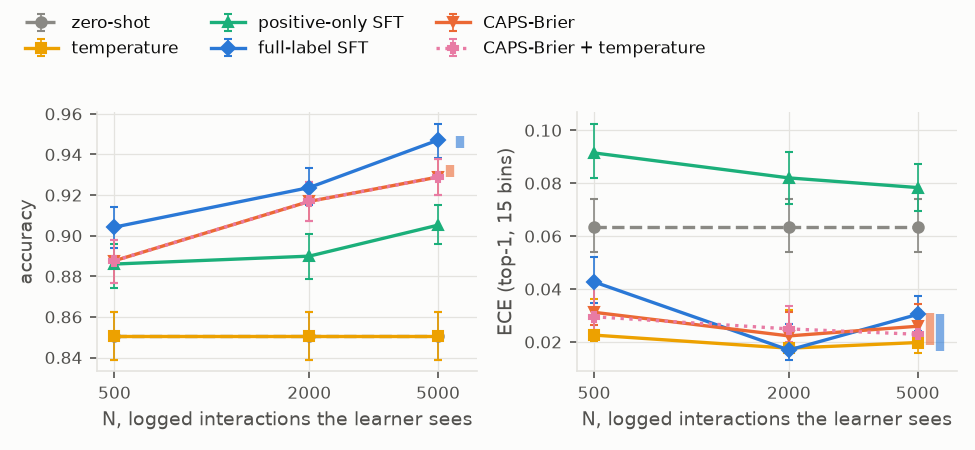

# jevmark

A small decision model that returns a probability for each option in one forward pass, without generating text.

[](https://arxiv.org/abs/2611.15572)
[](https://huggingface.co/yuanphd/jevmark)
[](https://huggingface.co/datasets/yuanphd/jevmark-runs)
[](LICENSE)

jevmark is a small decision model that answers without generating text. You send a message and questions with their options; in one forward pass, without changing its weights, it returns a probability for each option, and your code decides what to do with them. Because the options come with each request, it can answer with labels it never saw in training. It re-implements the idea behind TypeSafe AI's Jev on Qwen3-0.6B-Base and Qwen3-1.7B-Base with LoRA, and tests when learning from feedback improves on supervised training.

jevmark is not affiliated with or endorsed by TypeSafe AI. Their Jev model is the inspiration; the code, the data pipeline and the adapters were built and trained independently on open-source Qwen3 base models.

```python
import os
os.environ["JEVMARK_CHECKPOINT"] = "hf://yuanphd/jevmark/sft_06b"  # the Hub adapter

from jevmark import systemone

response = systemone(
    "Hi, I was charged twice for my March invoice and the export button still crashes "
    "every time I click it. I need this sorted today, please.",
    {"department": {
        "type": "choice",
        "instructions": "Which team should handle this message?",
        "criteria": {
            "billing": "Charges, invoices, refunds and payment problems",
            "technical": "Bugs, crashes, outages and integration problems",
            "account": "Login, profile and account settings",
            "other": None,
        },
    }},
)
print(response["answers"]["department"])
```

```json
{"type": "choice", "choice": "technical",
 "probabilities": {"billing": 0.3526, "technical": 0.6462, "account": 0.0003, "other": 0.0008},
 "confidence": 0.5252}
```

This is an excerpt of the full five-question demo under [Usage](#usage): the output above is the `department` answer recorded there. The message names both a double charge and a crash, and the model splits its probability between billing and technical rather than guessing.

## Results at a glance

- **In-domain:** accuracy 0.956 (0.6B) and 0.952 (1.7B) with ECE 0.013 and 0.015 on the CLINC150 test split, the distribution it was trained on, without a temperature.
- **Unseen intents:** on 20 CLINC150 intents held out of training, choice accuracy 0.868 and 0.885, against 0.975 and 0.974 in-domain; the domains themselves were seen in training.
- **Latency:** 47.7 ms (0.6B) and 74.8 ms (1.7B) per request, batch-1 median on a T4, against 777 ms for gpt-4.1-mini (sequential calls from the caller's network) and about 3 s for same-size JSON generation.
- **Overconfident on unseen schemas:** ECE 0.11 to 0.22 on AG News, emotion and Yelp, where the frozen base is better calibrated; one in-domain temperature does not fix it, because each schema needs its own (1.4 to 2.9).
- **Full labels:** none of four bandit objectives (REINFORCE with reward r and r minus p, CAPS-Brier, CAPS-log) beat cross-entropy plus one temperature on mean ECE over the four unseen schemas; with its own temperature the best is level, -0.002 [-0.006, +0.004]. 0.6B only, three seeds.
- **From logged feedback, N 5000:** on Banking77, CAPS-Brier leads positive-only SFT by 2.6 points [1.9, 3.3] with ECE 0.053 lower (three CAPS seeds against one baseline seed), and stays below full-label SFT by 1.5 points [1.0, 2.0] at 0.6B (three-seed means) and .6 points [.2, 1.1] at 1.7B (against one full-label seed). The feedback is simulated from gold labels.



The whole project in two pages is [docs/STORY.md](docs/STORY.md); the paper is on [arXiv](https://arxiv.org/abs/2611.15572); the reports are [docs/RESULTS_v1.md](docs/RESULTS_v1.md), [docs/RESULTS_v2.md](docs/RESULTS_v2.md) and [docs/RESULTS_v3.md](docs/RESULTS_v3.md).

## Install

Python 3.11 and [uv](https://docs.astral.sh/uv/):

```bash
make setup            # uv sync --extra dev
make test             # pytest on CPU, a tiny random Qwen3 config, a few minutes
```

Optional extras: `uv sync --extra serve` for the FastAPI wrapper (`scripts/serve.py`, `POST /v1/systemone`), `uv sync --extra baselines` for the OpenAI baseline.

## Usage

```python
import os
os.environ["JEVMARK_CHECKPOINT"] = "hf://yuanphd/jevmark/sft_06b"  # the Hub adapter, see below

from jevmark import systemone

response = systemone(
    "Hi, I was charged twice for my March invoice and the export button still crashes "
    "every time I click it. I need this sorted today, please.",
    {
        "department": {
            "type": "choice",
            "instructions": "Which team should handle this message?",
            "criteria": {
                "billing": "Charges, invoices, refunds and payment problems",
                "technical": "Bugs, crashes, outages and integration problems",
                "account": "Login, profile and account settings",
                "other": None,
            },
        },
        "refund_requested": {"type": "noul", "instructions": "Does the customer ask for money back?"},
        "needs_human": {"type": "noul", "instructions": "Does this message need a human agent rather than an automated reply?"},
        "severity": {
            "type": "score",
            "instructions": "How severe is the reported issue?",
            "criteria": [
                "Cosmetic; no impact on functionality",
                "Broken or degraded feature, but a workaround exists",
                "Blocking issue; no workaround exists",
            ],
        },
        "next_tool": {
            "type": "choice",
            "instructions": "Which tool should the support agent call first?",
            "criteria": {
                "lookup_invoice": "Fetch the customer's invoices and payment history",
                "open_bug_ticket": "File a bug report with the engineering team",
                "search_help_center": "Search help articles for a known answer",
            },
        },
    },
)
```

Real output of this call, from `sft_06b` on a laptop CPU (2026-10-05, `scripts/demo.py`; the field definitions are in docs/API_SPEC.md section 3), printed one answer per line:

```json
{
  "model": "jevmark-sft_06b",
  "answers": {
    "department": {"type": "choice", "choice": "technical",
      "probabilities": {"billing": 0.3526, "technical": 0.6462, "account": 0.0003, "other": 0.0008},
      "confidence": 0.5252},
    "refund_requested": {"type": "noul", "noul": 0.0216},
    "needs_human": {"type": "noul", "noul": 0.9557},
    "severity": {"type": "score", "score": 1.8884,
      "legend": {"0": "Cosmetic; no impact on functionality",
                 "1": "Broken or degraded feature, but a workaround exists",
                 "2": "Blocking issue; no workaround exists"},
      "probabilities": {"0": 0.0186, "1": 0.0744, "2": 0.907},
      "confidence": 0.676},
    "next_tool": {"type": "choice", "choice": "open_bug_ticket",
      "probabilities": {"lookup_invoice": 0.0081, "open_bug_ticket": 0.9813, "search_help_center": 0.0106},
      "confidence": 0.9036}
  },
  "usage": {"input_tokens": 265}
}
```

The default model is the bare backbone of `configs/base.yaml`. Set `JEVMARK_CHECKPOINT=runs/<run>` to load a trained run's adapter, `calibration.json` and `config.yaml`. Adapters are not in git: they come from the Kaggle training notebooks (docs/KAGGLE.md).

Three trained adapters are published on the Hugging Face Hub at [yuanphd/jevmark](https://huggingface.co/yuanphd/jevmark): `sft_06b` and `sft_17b` (the general decision model at both sizes) and `rlcd_banking77_06b` (sft_06b adapted to Banking77 from logged feedback with CAPS-Brier, docs/RESULTS_v3.md). Load one with a Hub reference, which downloads that folder once into the Hugging Face cache and uses its own `config.yaml`:

```bash
JEVMARK_CHECKPOINT=hf://yuanphd/jevmark/sft_06b python my_script.py
```

`JevMark.load(config, checkpoint=...)` takes the same `hf://<owner>/<repo>/<folder>` form. The model card is docs/MODEL_CARD.md. `systemone_batch` takes a list of requests. The full contract, validation rules and encoding are in docs/API_SPEC.md.

## Demo

```bash
uv run python scripts/demo.py                       # hf://yuanphd/jevmark/sft_06b, threshold 0.9
uv run python scripts/demo.py --checkpoint hf://yuanphd/jevmark/rlcd_banking77_06b --threshold 0.8
```

`scripts/demo.py` sends the request above in one call, prints the response, then applies one confidence threshold: an answer at or above it is acted on automatically, one below it is escalated to an LLM or a human. Confidence is the response field for choice and score and max(p, 1 - p) for noul. The questions and the threshold are defined in that one file. Real output, `sft_06b` on a laptop CPU, 2026-10-05:

```
confidence threshold 0.9:
  escalate   department        technical (p 0.6462)               confidence 0.5252
  automatic  refund_requested  no (P(yes) 0.0216)                 confidence 0.9784
  automatic  needs_human       yes (P(yes) 0.9557)                confidence 0.9557
  escalate   severity          level 1.89 of 0 to 2               confidence 0.6760
  automatic  next_tool         open_bug_ticket (p 0.9813)         confidence 0.9036

3 acted on automatically, 2 escalated
model load 1.5 s; the five-question call 404 ms on cpu
```

The five answers come from one forward pass of 265 tokens: 404 ms for that one call on the laptop CPU in fp32, after a 1.5 s model load with the weights already cached (the first run also downloads the 0.6B backbone and the 18 MB adapter). On a T4 the batch-1 median is 47.7 ms per request (docs/RESULTS_v1.md section 4). The message names both a double charge and a crash, and the model splits department between billing and technical, so that answer is escalated rather than guessed.

## Question types

- **noul:** a yes or no question; returns the probability of yes.
- **choice:** one of 2 to 26 options defined in the request, each with an optional description; returns a probability per option, the argmax and a confidence, 1 - H(p) / ln K.
- **score:** a position on 2 to 10 ordered levels described in the request; returns the level distribution, its expectation and a confidence.

Thresholds and routing are the caller's job: the model returns distributions, and policy lives in code.

## Backbones

Qwen/Qwen3-1.7B-Base is the main backbone and Qwen/Qwen3-0.6B-Base the development backbone; both are config switches (`configs/sft_06b.yaml`, `configs/sft_17b.yaml`). Training is LoRA only (r 16, alpha 32, q k v o), fp16 autocast with fp32 LoRA weights, on Kaggle T4s. v2's bandit arms and the v3 N-curve, off-policy, noise and emotion experiments ran on 0.6B; the logged-feedback comparison at N 5000 was repeated on 1.7B.

## Results by phase

Every number in the reports is cited to a committed `metrics.json`. The paper calls the logged-feedback learner Chosen-Action Proper Scoring (CAPS): the direct method of logged bandit feedback with a proper score on the chosen action (docs/METHOD.md). In the reports and run names CAPS-Brier and CAPS-log are `direct_brier` and `direct_log`, the released adapter `rlcd_banking77_06b` keeps its original name, and RLCD refers to the community reconstruction that motivated the study, which CAPS is not.

- **v1, the supervised model** ([docs/RESULTS_v1.md](docs/RESULTS_v1.md)): works in-domain and reads options it never saw; 25 to 33 points ahead of same-size JSON generation in-domain and on unseen intents; ahead of gpt-4.1-mini in-domain (0.944 and 0.945 against 0.908) and on SST-5, behind it on Banking77, emotion, Yelp and, at 0.6B, AG News (500-record subset). 1.7B helps only far from the training data.
- **v2, bandit objectives on full labels** ([docs/RESULTS_v2.md](docs/RESULTS_v2.md)): one temperature is the strongest cheap fix; a proper score used as a REINFORCE reward pushes probability away from gold (SST-5 score accuracy 0.636 to 0.111); no arm beats SFT plus that temperature, because with a known gold label the outcome carries less information than the label itself.
- **v3, adaptation from logged feedback** ([docs/RESULTS_v3.md](docs/RESULTS_v3.md)): sft_06b answered 9942 Banking77 messages with 10 percent exploration, and only whether its chosen answer was right was logged. Learners trained on the first N interactions; accuracy / ECE on the full Banking77 test split, seed 0:

| N | zero-shot | temperature | positive-only SFT | CAPS-Brier | full-label SFT |
|---|---|---|---|---|---|
| 500 | 0.851 / 0.063 | 0.851 / 0.023 | 0.886 / 0.091 | 0.888 / 0.031 | 0.904 / 0.043 |
| 2000 | | 0.851 / 0.018 | 0.890 / 0.082 | 0.917 / 0.022 | 0.924 / 0.017 |
| 5000 | | 0.851 / 0.020 | 0.905 / 0.078 | 0.929 / 0.026 | 0.947 / 0.030 |

  CAPS-Brier ties positive-only SFT at N 500 and leads from N 2000; full labels stay ahead and the gap does not shrink with N. Adaptation costs 2.7 to 4.3 in-domain points for CAPS-Brier at N 5000.
- **Phase 4, experiments for the paper** (docs/RESULTS_v3.md sections 4 and 11 to 13): propensity weights add nothing; on emotion, with a logging policy wrong on more than half the log, CAPS-Brier leads positive-only SFT by 21.7 points [19.7, 23.8] at N 5000 (seed 0) and stays 4.3 points [3.1, 5.6] below full labels (one full-label seed); at 1.7B it leads positive-only SFT by 3.4 points [2.6, 4.1]; under feedback flipped at a known rate of 0.1 to 0.3, inverting the rate brings ECE to 0.020, 0.051 and 0.068 against 0.026 clean.

## Limits

v2 ran on 0.6B only; all feedback is simulated from gold labels, with one logging policy per domain; at 1.7B and on emotion the baselines have one seed. Together with v2, the claim that survives is narrow: CAPS-Brier adds value over positive-only SFT when feedback is partial, and nowhere else tested.

## Data and leak gates

```bash
make data       # build the nine v1.3 splits into data/, then the CPU gates
make data-v3    # the v3 Banking77 files next to them, then the leak probes on them
```

Training data is CLINC150 (choice and noul) and SST-5 (score), with 20 intents held out and four schemas never trained on (AG News, emotion, Banking77, Yelp). `make data` fails unless every build check passes, state-free linear and boosted-tree leak probes find no question answerable from its structure alone (no lift above 10 points, or above 3 points and the 99th percentile of shuffled-target runs), and no test text appears in train or valid. Dataset ids, revisions, record schema and the gates are in docs/DATA.md; data hashes are pinned in `data/baseline_subset.json` and `configs/v3_data.yaml`.

## Reproducing the tables

Every run's `metrics.json`, config and training log are committed under `runs/`.
The per-question files and the deployment logs are published as the Hugging Face dataset [yuanphd/jevmark-runs](https://huggingface.co/datasets/yuanphd/jevmark-runs).
The command for every table and figure is in [docs/REPRODUCE.md](docs/REPRODUCE.md).

## Documentation

- docs/STORY.md: the whole project in two pages.
- docs/RESULTS_v1.md, docs/RESULTS_v2.md, docs/RESULTS_v3.md: the reports, every number cited to a `metrics.json`.
- docs/REPRODUCE.md: the command behind every table and figure.
- docs/API_SPEC.md: the request and response contract.
- docs/DATA.md, docs/KAGGLE.md: data, and how to run on Kaggle.
- docs/MODEL_CARD.md: the card of the adapters on the Hugging Face Hub.
- docs/audit/SUMMARY.md, docs/audit/EMOTION_SUMMARY.md: the Banking77 and emotion label-noise audits.
- Paper: "Learning a calibrated decision head from logged bandit feedback", [arXiv:2611.15572](https://arxiv.org/abs/2611.15572).
- docs/METHOD.md: the method statement; docs/references.bib: the paper's references, each checked against the arXiv listing, the publisher's DOI record or the proceedings page.
- docs/figures/paper/: the paper's figures, drawn from the committed metrics files.
- docs/audit/REPO_CONSISTENCY.md: the check of this repository against the paper before submission.
- Hugging Face: the adapters at [yuanphd/jevmark](https://huggingface.co/yuanphd/jevmark), the deployment logs and per-record results at [yuanphd/jevmark-runs](https://huggingface.co/datasets/yuanphd/jevmark-runs).

## Citation

The paper is on arXiv as [2611.15572](https://arxiv.org/abs/2611.15572). The code it describes is at tag `v5-paper`.

```bibtex
@misc{yuan2026calibrated,
  title         = {Learning a calibrated decision head from logged bandit feedback},
  author        = {Yuan, Ye},
  year          = {2026},
  eprint        = {2611.15572},
  archivePrefix = {arXiv},
  primaryClass  = {cs.LG}
}
```

## Use of AI assistance

The code, the experiment pipeline, the project reports and the first draft of the paper were written with Claude Code (Anthropic) under the author's direction and review. The label audits were judged by two language models, Claude and GPT, with no human pass, as stated in the limitations. The related-work survey was compiled with an AI research tool, and every bibliographic entry was then verified against primary sources. All experiments, numbers, claims and the final text are the author's responsibility.

## License

Apache License 2.0, the same as the adapters on the Hugging Face Hub. See LICENSE.

## Contact

yuan.phd.ai@gmail.com
