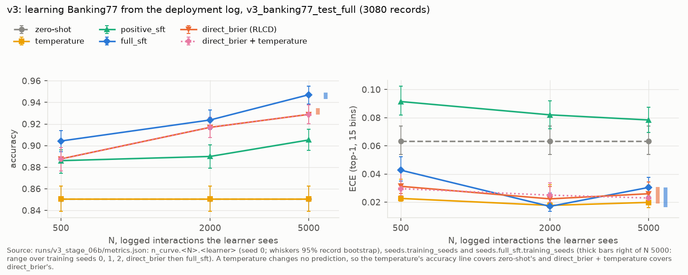
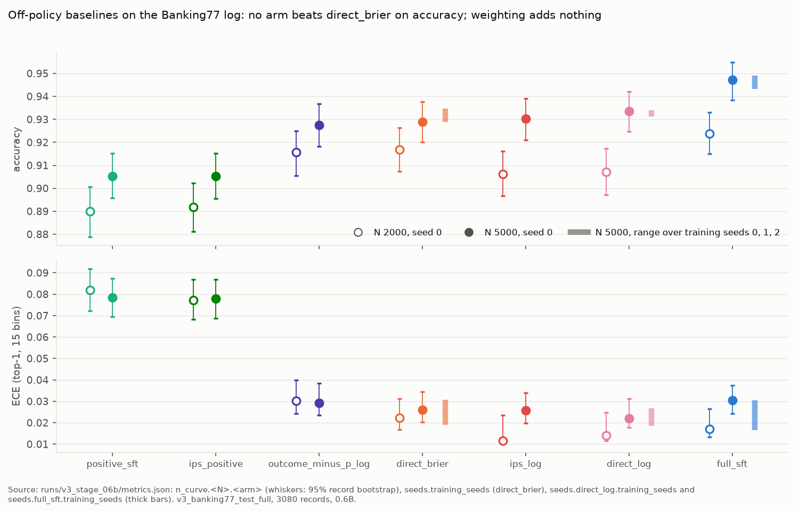
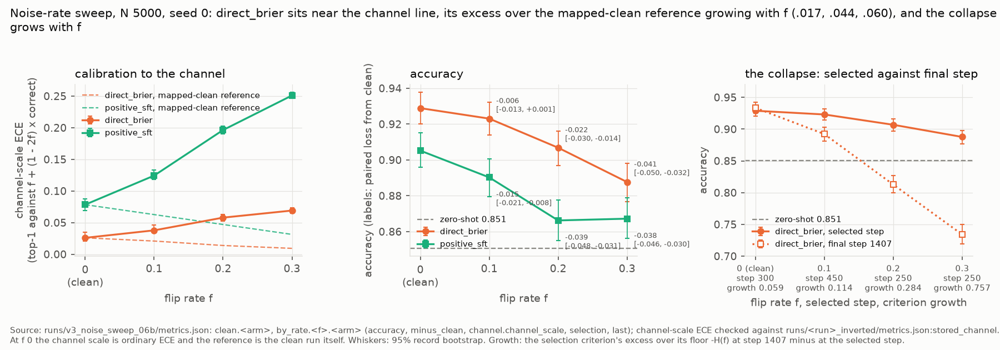
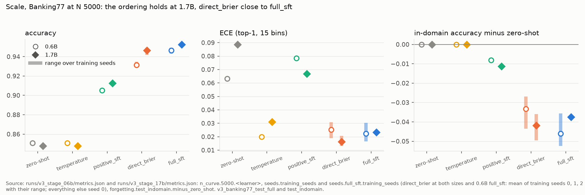
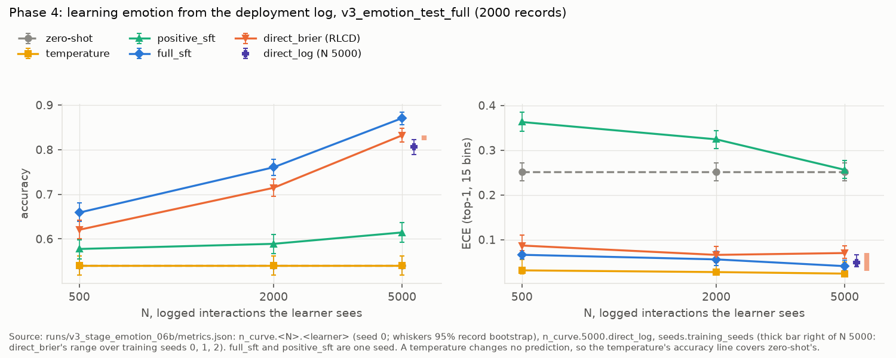

# Learning a calibrated decision head from logged bandit feedback

*Draft, second pass. Workshop length: main text sections 1 to 8, then the appendix.*

Every number cites the report section and the committed metrics file it comes from. Report sections are RESULTS_v1, RESULTS_v2 and RESULTS_v3 (`docs/RESULTS_v*.md`), and docs/METHOD.md. Metrics files are given as `path:key`, with four shortcuts:
- `S:` for `runs/v3_stage_06b/metrics.json`;
- `N:` for `runs/v3_noise_sweep_06b/metrics.json`;
- `L:` for `runs/v3_stage_17b/metrics.json`;
- `E:` for `runs/v3_stage_emotion_06b/metrics.json`.

The abstract's numbers are cited where they recur in Section 5 and the appendix. BibTeX entries for every reference are in `docs/references.bib`, each checked against the arXiv listing, the publisher's DOI record or the proceedings page.

## Abstract

A decision head reads a state and a list of options and returns a probability for each option in one forward pass; a caller answers when the top probability clears a threshold and escalates otherwise. Once deployed, it usually observes only whether the option it chose was right: logged bandit feedback. We adapt such a head, a LoRA adapter on Qwen3-0.6B-Base and 1.7B-Base, from that feedback, and report three results.
1. **A proper score of the sampled action's own probability is not a usable REINFORCE reward.** That a detached, parameter-dependent reward drops the pathwise term of the gradient is known; we give the corollary for this reward. Against a group-mean baseline every wrong action earns at least the gold action's reward, the lowest-probability wrong action sampled gets the largest advantage, and at K = 2 the signal is exactly zero. In practice it cut one score task's accuracy from .636 to .111.
2. **With full labels, no bandit objective beat cross-entropy plus one temperature on calibration under label-space shift.** This replicates a concurrent finding under a stricter protocol: transfer to unseen label schemas, a continued cross-entropy control, and four bandit arms under one temperature. The best arm was level, -.002 [-.006, +.004].
3. **From logged bandit feedback alone, Chosen-Action Proper Scoring (CAPS) works.** CAPS is the direct method with a proper score: it fits the chosen action's probability to its logged outcome by the pathwise gradient. On Banking77 it beats fine-tuning on confirmed answers only, which is positive-unlabeled learning with the negatives discarded, by +2.6 points [1.9, 3.3] in accuracy, .053 in ECE and .0095 in AURC. It stays 1.5 points [1.0, 2.0] below full-label training at 0.6B and .4 points [-1.0, +.2] below it at 1.7B. Propensity weights add nothing, as expected of a well-specified regression. Under feedback flipped at a known rate, CAPS calibrates to the noisy channel without any correction, backward correction maps it back, and early stopping on the held-out log-likelihood of logged outcomes prevents the memorisation of the single noisy draw.

## 1. Introduction

**The decision head.** A decision head answers typed questions about a text state: yes or no, one of K options, or a level on a scale. The options are part of each request, so the same model answers label sets it was never trained on. It returns a full distribution per question from the option-letter probabilities at an answer slot, in one forward pass, with no text generated. The caller's code turns the probabilities into actions, for example by answering above a confidence threshold and escalating below it, which is selective classification with a reject option. That only works if the probabilities are calibrated and rank the errors lowest. Ours is a LoRA adapter on Qwen3-0.6B-Base and 1.7B-Base. Its in-domain ECE is .013 to .015, but it is overconfident on unfamiliar schemas, with ECE up to .22 (RESULTS_v1 section 2, `runs/sft_{06b,17b}/metrics.json:splits.<split>.overall.ece`). The setting is the one TypeSafe AI announced with Jev (TypeSafe AI 2026), trained by an unpublished recipe called RLCD, reinforcement learning for calibrated decisions; jevmark is an independent re-implementation of the concept.

**Why logged bandit feedback is the realistic case.** After deployment on a new domain, labels are expensive and rare. What a system does record is whether the action it took turned out right: a ticket reopened or not, a routing corrected or not. This is logged bandit feedback: one outcome per interaction, only for the chosen action, under a known logging policy. The common practice is to fine-tune on the interactions that went well and discard the rest. That discards the negatives, which makes it positive-unlabeled learning, and, as we show, leaves the model overconfident (Section 5.3).

**This paper.** It makes three claims, the third of which is the core.
1. **A corollary on detached proper-score rewards.** The general principle is that a detached, parameter-dependent reward drops the pathwise term of the gradient (Schulman et al. 2015; Mohamed et al. 2020). Our contribution is the specific algebra when the reward is a proper score of the sampled action's own probability: a wrong action's reward is never below gold's, the lowest-probability wrong action sampled gets the largest advantage, and the signal is exactly zero at K = 2 (Section 3); and the measured collapse (Section 5.2). The concurrent OpenJev-RLCD (Gao and Wang 2026) reaches the same recipe, pathwise gradient only and the score-function term harmful, by a gradient-norm argument for a different object: its REINFORCE term acts on a sampled rationale, not on the answer whose probability is scored. Bereket and Leskovec (2025) and Damani et al. (2025) show that REINFORCE with a proper-score reward works when the forecast is a separately emitted probability, and Bereket and Leskovec trace GRPO's overconfidence to dividing the advantage by the group standard deviation. Our group baseline subtracts the group mean only, with no standard-deviation normalisation (`rlcd.normalize_std: false` in every full-label run, and a batch mean only in the logged-feedback REINFORCE arm), so their failure mode does not apply, and our pathology is specific to scoring the sampling probability itself.
2. **A replication, under a stricter protocol, that full labels leave nothing for bandit objectives.** OpenJev-RLCD's direct-scorer ablation reports that proper-score RL never beat cross-entropy on CLINC150 (94.6 against 96.3 accuracy) and that RLVR collapsed to the mode. We find the same direction and add the transfer-to-unseen-schema protocol, the continued cross-entropy control, four bandit arms under one temperature, and the finding that a single temperature is the strongest cheap fix (Section 5.2). The direction is not new.
3. **Learning from logged bandit feedback with CAPS.** CAPS is the direct method of logged bandit feedback (Dudík, Langford and Li 2011), trained with a proper score on the chosen action, the regression-oracle objective (Foster et al. 2018; Foster and Rakhlin 2020). What is new is the package for LoRA-adapted LLM decision heads at 2000 interactions:
   - positive-only fine-tuning diagnosed as positive-unlabeled learning (Elkan and Noto 2008) and beaten from 2000 interactions on, with better calibration and selective risk at every log size;
   - no gain from propensity weights, the expected behaviour of a well-specified regression (Shimodaira 2000; Byrd and Lipton 2019);
   - calibration to the noisy channel without correction, and backward correction (Natarajan et al. 2013; Patrini et al. 2017) with its 1 / (1 - 2f) factor (Angluin and Laird 1988);
   - memorisation of a fixed noisy log, and checkpoint selection on the held-out log-likelihood of logged outcomes, which needs no label.

**What the paper does not show.**
- The feedback is simulated from gold labels, cleanly or with symmetric flips at a known rate.
- Two adaptation domains, Banking77 and emotion, with one log each.
- 1.7B is one seed [pending session L].
- No counterfactual-risk policy learner (POEM or BanditNet), no doubly robust arm and no off-policy value estimate of the learned policy (Section 6).
- The gap to full labels does not shrink as the log grows (RESULTS_v3 section 8).

## 2. Related work

**Calibrated decision heads for agents.** A small model that answers typed questions about a state in one forward pass, with a confidence its caller thresholds, is the setting of Jev (TypeSafe AI 2026) and of its only published reconstruction, OpenJev-RLCD (Gao and Wang 2026). Its use is the cascade: a cheap model answers what it is sure of and defers the rest to a larger model or a person (Chen, Zaharia and Zou 2023; Ong et al. 2024; Belcak et al. 2025), and routing work that trains the confidence into the small model finds that calibrated confidence gives the better deferral trade-off (Chuang et al. 2025; Hao et al. 2026). Thresholding the top posterior is selective classification (Chow 1970; Geifman and El-Yaniv 2017), and we evaluate the caller by its risk-coverage curve. Reading option-letter logits in one forward pass is the multiple-choice convention (Hendrycks et al. 2021; Robinson, Rytting and Wingate 2023; Kadavath et al. 2022), with known selection bias toward option letters and sensitivity to option order (Zheng et al. 2024; Pezeshkpour and Hruschka 2024; Zhao et al. 2021); we randomise option order in every split and report accuracy by gold letter position (RESULTS_v1 section 3). Language models can also state a confidence in words (Lin, Hilton and Evans 2022; Tian et al. 2023; Xiong et al. 2024); our head never generates text, and its confidence is the distribution over the options it read.

**Learning from logged bandit feedback.** CAPS is the direct method of logged bandit feedback (Dudík, Langford and Li 2011), the regression-oracle objective (Foster et al. 2018; Foster and Rakhlin 2020), which the bake-off of Bietti, Agarwal and Langford (2021) found competitive without propensity weights. The other family, counterfactual risk minimisation, weights the policy objective by inverse propensities, with variance penalties, self-normalisation and clipping (Swaminathan and Joachims 2015a; Swaminathan and Joachims 2015b; Joachims, Swaminathan and de Rijke 2018; Bottou et al. 2013); doubly robust estimators combine the two (Dudík, Langford and Li 2011). Simulating bandit feedback from a labelled multiclass dataset is the field's standard protocol (Beygelzimer and Langford 2009; Dudík, Langford and Li 2011). OpenJev-RLCD's stage 1 scores the whole readout distribution against the one-hot label, with full information; CAPS scores one component, the chosen action's probability against its own outcome, because partial feedback reveals nothing else. Importance weights are unnecessary for a well-specified conditional model (Shimodaira 2000) and have little effect on deep networks trained to convergence (Byrd and Lipton 2019). Fine-tuning on confirmed answers only is positive-unlabeled learning, which recovers the posterior only up to a constant (Elkan and Noto 2008), and is the decision-head form of self-training on filtered successes (Zelikman et al. 2022; Yuan et al. 2023; Gulcehre et al. 2023); unlikelihood training is its counterpart that keeps the negatives (Welleck et al. 2020). We add the instantiation for LoRA-adapted LLM decision heads at 2000 interactions, the comparison with positive-only fine-tuning, the noisy channel and label-free checkpoint selection.

**Proper scoring rules as losses and as rewards.** A strictly proper score is minimised in expectation by the true probability (Brier 1950; Gneiting and Raftery 2007), which makes it a calibration-respecting loss and, when the forecast is a separately emitted probability, a sound reward. As losses, the Brier and log scores train calibrated networks (Lakshminarayanan, Pritzel and Blundell 2017), and square loss matches cross-entropy for classification (Hui and Belkin 2021); the two trade within one family through the reliability and resolution decomposition (Murphy 1973; Bröcker 2009). Calibration is summarised by binned ECE (Pakdaman Naeini, Cooper and Hauskrecht 2015), whose bias is why we report Brier and NLL beside it (Nixon et al. 2019; Kumar, Liang and Ma 2019; Ferrer and Ramos 2024), and repaired post hoc by one temperature (Guo et al. 2017). As RL rewards on a verbalized or token-level confidence, proper scores yield calibrated models (Band et al. 2024; Bani-Harouni et al. 2025; Damani et al. 2025), and Bereket and Leskovec (2025) show that the estimator, not the score, then decides calibration: an unbiased group baseline gives calibrated forecasts and GRPO's standard-deviation normalisation drives them to the extremes. Our group baseline is the mean only, so that failure does not arise here.

**Calibration in RL for language models and the gradient question.** That a detached, parameter-dependent reward drops the pathwise term of the gradient is the general rule of stochastic computation graphs (Schulman et al. 2015; Mohamed et al. 2020), and our first result is its corollary for a proper score of the sampled action's own probability. REINFORCE (Williams 1992) with a group baseline is the estimator of GRPO (Shao et al. 2024) and, leave-one-out, of RLOO (Ahmadian et al. 2024). Outcome-only rewards degrade calibration (OpenAI 2023; Kalai et al. 2025; Damani et al. 2025), and routing the calibration signal through a separate path repairs it (Ma et al. 2026); error-penalised RL with an abstention gate can saturate both the reward gradient and the KL anchor (Che et al. 2026). OpenJev-RLCD (Gao and Wang 2026) optimises the readout distribution by the pathwise gradient of a proper score, which it calls the deterministic policy gradient with respect to the reported distribution, measures the score-function term at 7 to 12 times the pathwise term's gradient norm and finds more of it monotonically worse; that term acts on a sampled rationale. Its direct-scorer ablation reports that proper-score RL never beat cross-entropy on CLINC150 (94.6 against 96.3) and that RLVR collapsed to the mode. Our second result agrees under a transfer protocol with a continued cross-entropy control.

**Noisy feedback.** Feedback flipped at a known rate f is random classification noise on the outcome (Angluin and Laird 1988), and the observed outcome rate f + (1 - 2f) P(correct) that CAPS fits is the symmetric case of the class-conditional identity (Natarajan et al. 2013), with the clean posterior an affine transform of the corrupted one (Menon et al. 2015). Inverting it is backward correction with a known transition matrix (Patrini et al. 2017), whose error grows by the 1 / (1 - 2f) factor of Angluin and Laird; the same correction appears for noisy preferences (Chowdhury, Kini and Natarajan 2024). Agarwal and Manwani (2021) study flipped bandit feedback with a known rate for an online linear learner. Networks memorise noisy labels given enough passes (Zhang et al. 2017; Arpit et al. 2017), and early stopping is the provable remedy (Li, Soltanolkotabi and Oymak 2020). We add that a pathwise proper score on noisy chosen-action feedback learns the noisy posterior without any correction, which is what makes backward correction possible, that the residual is the variance of one draw per interaction, and that early stopping can be driven by the held-out log score of logged outcomes.

**Calibration under shift and after fine-tuning.** A single temperature is strong in-domain and fragile under shift (Ovadia et al. 2019; Desai and Durrett 2020; Chen et al. 2023), and our second result says the bandit alternatives are no less fragile on unseen label schemas. Domain-dependent temperatures address the shift directly (Yu, Bates, Ma and Jordan 2022). Post-training degrades calibration (OpenAI 2023; Zhu et al. 2023; Leng et al. 2025), while a small amount of fine-tuning on graded examples can teach calibration that transfers (Kapoor et al. 2024). Adaptation costs in-domain accuracy, as LoRA forgets less than full fine-tuning but still forgets (Biderman et al. 2024; Kumar et al. 2022).

**Dataset quality and evaluation hygiene.** Our leak probes are leakage detection by exploratory models on non-target features (Kaufman et al. 2012) against a permutation null (Ojala and Garriga 2010) and a control task (Hewitt and Liang 2019), the guard the annotation-artifact and shortcut literature calls for (Gururangan et al. 2018; Poliak et al. 2018; Geirhos et al. 2020); the duplicate check addresses train-test overlap (Elangovan, He and Verspoor 2021; Lewis, Stenetorp and Riedel 2021). Benchmark test sets contain label errors (Northcutt, Athalye and Mueller 2021; Northcutt, Jiang and Chuang 2021). For Banking77, Ying and Thomas (2022) flag about 1,400 of 13,083 utterances, about 11 percent, in line with our audit's .12 and .14. The emotion dataset is distantly supervised from hashtags (Saravia et al. 2018), which human validation puts at about 90 percent label accuracy (Abdul-Mageed and Ungar 2017); our audit finds a problem in a third of a uniform sample.

## 3. Method: Chosen-Action Proper Scoring

**Setting.** A logged interaction is (x, O, a, q(a | x), r):
- x is a state and O its K options;
- a is the action the logging policy q chose, and q(a | x) its logging propensity, recorded exactly;
- r in {0, 1} records whether a was right.

The learner starts from a general decision head p_theta and sees only the log. In our experiments q = 0.9 p_0 + 0.1 / K, epsilon-greedy over the starting model p_0, so every option has support (RESULTS_v3 section 1, `runs/v3_log_s0/metrics.json`).

**Objective.** CAPS minimises

  L(theta) = E_x E_{a ~ q(. | x)} [ S(p_theta(a | x), r(x, a)) ]

with S a strictly proper binary score: Brier, (r - p)^2, by default, or the log score. The empirical mean over the log estimates L directly. The gradient is the pathwise gradient through p_a; for Brier it is -2 (r - p_a) dp_a / dtheta. A right action is pushed up and a wrong one down.

**Identity.** CAPS is the direct method of Dudík, Langford and Li (2011), with a proper score as the regression loss on the chosen action's outcome and the argmax of the fitted head as the policy, and it is OpenJev-RLCD's stage 1 specialised to partial feedback: where stage 1 scores the whole readout distribution against the one-hot label, CAPS scores the one component the log reveals, the chosen action's probability against its own outcome.

**Why no propensity weight.** For each (x, a) with q(a | x) > 0, the inner term is minimised at p(a | x) = P(r = 1 | x, a), whatever q is. The regression target does not depend on the logging policy as long as it has support, so the unweighted fit is consistent for a well-specified model (Shimodaira 2000). The propensity only sets how a finite model trades errors between actions, and L makes that trade as the deployed policy acts. A weight 1 / q would retarget it to a uniform average over options.

Accuracy is a consequence, not the objective: moving right actions up and wrong ones down moves the argmax. A negative on an option other than the logger's top choice arises only from the logger's randomness. On our main log, 1514 of 2593 negatives (.584) fall on such options, and about .545 of those come from the uniform exploration term (docs/METHOD.md section 2, `runs/v3_log_s0/metrics.json:negatives`). Options the logger never takes are unconstrained by the objective.

**Corollary (a proper score of the sampled action's probability as a detached reward).** Take K options, gold g, and a proper score used as the reward of the sampled action:
- Brier: R(a) = 1 - (r_a - p_a)^2;
- log score: R(a) = r_a log p_a + (1 - r_a) log(1 - p_a).

The gradient of the expected reward, sum_a p_a R(a), has a score-function term, sum_a R(a) dp_a, and a pathwise term, sum_a p_a dR(a). Detaching R keeps only the first (Schulman et al. 2015). Form REINFORCE advantages against the mean of a sampled group, the sample itself included and not divided by the group standard deviation.

(i) If K > 2, every wrong action's reward is at least gold's. In each group, the lowest-probability wrong action sampled has the largest reward, so its advantage is non-negative. Whenever the group also samples gold, gold's advantage is non-positive.

(ii) If K = 2, all rewards in every group are equal, and the gradient is zero.

*Proof.* A wrong action w has r_w = 0 and p_w <= 1 - p_g.
- Under Brier, R(w) = 1 - p_w^2 and R(g) = 1 - (1 - p_g)^2. Under the log score, R(w) = log(1 - p_w) and R(g) = log p_g.
- Both rewards decrease in p_w and equal R(g) at p_w = 1 - p_g. Hence R(w) >= R(g), and the smallest sampled p_w gives the group maximum.
- At K = 2, p_w = 1 - p_g exactly, so R(w) = R(g). ∎

The score grades p_a as a forecast of r_a, and a low probability on a wrong option is always a good forecast. CAPS uses the same score as a loss on p_a by its pathwise gradient, not as a reward on a. Neither statement depends on the standard-deviation normalisation that Bereket and Leskovec (2025) identify as GRPO's source of overconfidence: our full-label runs use a group of 4 and subtract its mean only (`rlcd.normalize_std: false` in `configs/rlcd_06b.yaml` and in the `config.yaml` of all 31 full-label runs), and the logged-feedback REINFORCE arm subtracts the batch mean only. Nor does the corollary contradict the proper-score rewards of Damani et al. (2025) and Bereket and Leskovec (2025), which score a confidence the model emits separately, not the probability with which it sampled the action being rewarded.

**Selection.** Train on the first 0.9 N interactions. Keep the checkpoint, from a 50-step grid, with the highest mean Bernoulli log-likelihood of the logged outcomes under p(logged action) on the last 0.1 N: early stopping on the held-out log score of logged outcomes. No gold label is read (RESULTS_v3 section 1). Under noisy feedback this is what prevents memorisation (Section 5.3).

## 4. Relation to the baselines

- **Temperature** fitted to the logged outcomes: post-hoc and global, and it changes no argmax.
- **positive_sft**: cross-entropy on confirmed actions, positive-unlabeled learning with the negatives discarded, not unobserved. What practitioners do.
- **full_sft**: cross-entropy on gold for every logged interaction. The upper bound, at one label per interaction.
- **Off-policy forms**, all on the same log:
  - REINFORCE with reward r - p_a, detached, a batch-mean baseline and the importance weight min(p / q, 5) (outcome_minus_p_log);
  - CAPS with the log score and inverse propensity weighting of the direct-method loss, min(1 / q, 5) divided by its mean over the training prefix (ips_log), which is importance-weighted regression;
  - positive_sft with the same weights (ips_positive).

The weighted forms reweight the direct-method loss. They are not counterfactual risk minimisation, which weights the policy objective itself; that arm was not run (Section 6). In tables, CAPS with the Brier score is the run name direct_brier, and with the log score direct_log.

## 5. Experiments

### 5.1 Setup

**Model and data.**
- Qwen3-0.6B-Base and 1.7B-Base with LoRA (r 16, alpha 32, attention projections) (Hu et al. 2022; Qwen Team 2025). Answers are read from the letter logits at each question's answer slot in one forward pass.
- Supervised training uses CLINC150 intents (Larson et al. 2019) and SST-5 sentiment (Socher et al. 2013). Options are sampled per record, with negated yes-or-no phrasings.
- Evaluation covers 20 held-out intents and four schemas never trained on: AG News, Yelp (Zhang, Zhao and LeCun 2015), emotion (Saravia et al. 2018) and Banking77 (Casanueva et al. 2020) (RESULTS_v1 section 1).

**Leak and duplicate gates.** Before any GPU run, the data must pass two CPU checks (RESULTS_v1 section 3):
- state-free leak probes: classifiers on phrasing, question text and structure, which must not beat chance by more than a fixed margin and a shuffled-target null;
- train-test duplicate rules.

The Banking77 log domain drops 30 messages that match the test split and 31 repeats (RESULTS_v3 section 1, `data/v3_manifest.json`).

**Adaptation protocol** (RESULTS_v3 section 1). Supervised-to-bandit conversion with a decision head as the logger.
- The 0.6B model logs every message of the Banking77 train split once: 9942 messages, each a 10-option choice with gold always present. It samples from q = 0.9 p + 0.1 / K and records only the correctness of its action. Policy accuracy is .836 and the outcome rate .739 (`runs/v3_log_s0/metrics.json`).
- Learners see the first N in {500, 2000, 5000} interactions. All trained learners take the same number of steps, max(200, ceil(10 x 0.9 N / 32)), at lr 5e-5.
- Evaluation is on the full Banking77 test split (3080 records), plus test_indomain and test_unseen_intents for forgetting.
- Intervals are 95 percent bootstrap over records (Efron 1979; Efron and Tibshirani 1993), 1000 resamples, paired across runs.
- At N 5000, CAPS-Brier, CAPS-log and full_sft each have three training seeds, and CAPS-Brier also has a second log draw.

**Metrics.** Accuracy, ECE with 15 equal-width bins, Brier and NLL, and two selective-classification metrics for the caller who thresholds (Geifman and El-Yaniv 2017). Questions are ranked by top-1 probability. AURC is the area under the risk-coverage curve, the mean error of the kept answers over all coverages; Cov@eps is the largest share of questions a top-1 threshold keeps with error at most eps, for eps in {.05, .10, .20}, with ties in top-1 kept or dropped together. Lower AURC and higher Cov@eps are better. Every trained learner reaches Cov@.20 = 1, and from N 2000 Cov@.10 = 1 as well, so the tables show Cov@.05. The same metrics ranked by the response's confidence field, 1 - H / ln K, are stored under `_entropy` keys.

A temperature changes the level of the probabilities and only slightly their ranking: one temperature is monotone within a question but can reorder top-1 probabilities across questions. At N 5000 the temperature learner cuts zero-shot ECE from .063 to .020 but moves AURC only from .0333 to .0328 and Cov@.05 from .756 to .765 (`S:n_curve.5000.{zero_shot,temperature}`); on CAPS-Brier, whose fitted temperature is near 1, it moves AURC by under .0001 (`S:n_curve.5000.direct_brier_temp_minus_direct_brier.aurc`).

### 5.2 Full labels: the negative results (v2)

**The broken reward.** A first run used Brier as a detached REINFORCE reward on fully labelled in-domain data, group of 4, mean baseline without standard-deviation normalisation (RESULTS_v2 section 2, `runs/sft_06b/metrics.json` and `runs/rlcd_06b_brier_s0/metrics.json:splits.<split>.score.accuracy`; `runs/rlcd_06b_brier_s0/config.yaml:rlcd.normalize_std`).
- Score accuracy fell from .636 to .111 on SST-5 and from .505 to .044 on Yelp.
- A simulation of the sampler on the SFT model lowered the gold logit in 24.0 percent of questions and raised it in 1.8 percent (`runs/advantage_simulation_06b/metrics.json:rewards`).

This is the corollary of Section 3 at work.

**No gain from bandit objectives on full labels.** Five arms (RESULTS_v2 section 3, `runs/rlcd_stage2a_06b/metrics.json:unseen_schemas`, `:temperature_ablation`):
- continued cross-entropy (the control);
- two REINFORCE arms with detached rewards, outcome and r - p;
- CAPS with Brier and with the log score, by the pathwise gradient.

Each ran three seeds at 0.6B. Against SFT plus one in-domain temperature (unseen-schema mean ECE .121, `runs/rlcd_stage2a_06b/metrics.json:unseen_schemas.mean_ece.sft_temp`):
- every arm's unseen-schema ECE is higher, by +.031 to +.127 (`runs/rlcd_stage2a_06b/metrics.json:unseen_schemas.arms.<arm>`);
- given its own temperature, the best arm is level, -.002 [-.006, +.004], and so is the control, +.002 [-.001, +.009] (`runs/rlcd_stage2a_06b/metrics.json:temperature_ablation.arms.<arm>`).

When gold is known, whether a sampled answer was right carries no more than the label itself, and one temperature is the strongest cheap fix. OpenJev-RLCD reports the same direction on CLINC150 with a different training setup; the transfer to unseen schemas and the continued cross-entropy control are ours. Figure `figures/v2_arm_ece.png` shows the arms.

### 5.3 Logged bandit feedback only (v3, Banking77)

**The N-curve** (RESULTS_v3 section 2, `S:n_curve.<N>`; Figure `figures/v3_n_curve.png`; Table A.1).
- *Against positive_sft:* CAPS-Brier ties on accuracy at N 500, +.002 [-.006, +.009]. It leads by +.027 [+.019, +.035] at N 2000 and +.024 [+.016, +.031] at N 5000. Its ECE is lower by .052 to .060 and its AURC by .0035 to .0099 at every N; its Cov@.05 is level at N 500 and higher by +.065 [+.048, +.093] and +.069 [+.046, +.094] at N 2000 and 5000 (`S:n_curve.<N>.direct_brier_minus_positive_sft`).
- *Against full_sft:* it stays 0.7 to 1.8 points below in accuracy and .0026 to .0047 above in AURC.
- *Gap closed:* it closes 69, 91 and 81 percent of the accuracy gap between zero-shot and full_sft at N 500, 2000 and 5000, computed from the stored accuracies (`S:n_curve.<N>.<learner>.accuracy`).
- *The temperature learner* keeps zero-shot accuracy (.851) and has the lowest or joint-lowest ECE (.020 at N 5000; `S:n_curve.<N>.temperature`). Its Brier, NLL and AURC stay far above every trained learner's.

**Seeds** (RESULTS_v3 section 3, `S:seeds`; Table A.2).
- Over three training seeds at N 5000, CAPS-Brier is +.026 [+.019, +.033] over positive_sft in accuracy and -.0095 [-.0121, -.0070] in AURC, and -.015 [-.020, -.010] below full_sft's seed mean, with ECE level, +.003 [-.001, +.008].
- Training seeds and the second log draw move accuracy by at most .6 points.
- A temperature fitted on CAPS-Brier's own training interactions comes out near 1 (.951 to 1.039) and moves ECE by at most .003 (`S:direct_brier_temperatures`).

**Off-policy baselines** (RESULTS_v3 section 11, `S:n_curve.<N>.off_policy`; Figure `figures/v4_offpolicy.png`; Table A.3).
- Every arm that keeps the negatives leads positive_sft, by +.016 to +.028 in accuracy.
- ips_positive equals positive_sft: +.002 [-.001, +.005] in accuracy at N 2000 and +.000 [-.003, +.004] at N 5000, and +.0003 [-.0003, +.0009] and +.0002 [-.0005, +.0010] in AURC (`S:n_curve.<N>.off_policy.ips_positive.minus_positive_sft`). At N 5000, only 25 of the 3342 positives it trains on are clipped (`runs/v3_06b_ips_positive_n5000_s0/train_summary.json:ips`). With full support and a well-specified regression target, this is the expected result.
- No arm beats CAPS-Brier on accuracy with an interval excluding 0.
- At N 5000, ips_log beats CAPS-Brier on Brier and NLL, but the unweighted CAPS-log beats it by more, so the gain is the log score's, not the weight's.
- Over three seeds, CAPS-log against CAPS-Brier at N 5000 is +.002 [-.001, +.005] in accuracy, -.005 [-.008, -.001] in Brier, -.020 [-.029, -.010] in NLL and -.0008 [-.0016, +.0000] in AURC (`S:seeds.direct_log_seed_mean_minus_direct_brier_seed_mean`).
- CAPS-log forgets more in-domain (-.038 to -.046 against -.027 to -.043) and is behind at N 2000 on one seed (-.010 [-.016, -.004]).

Brier stays the default.

**Noisy feedback** (RESULTS_v3 section 4, `N:by_rate`; Figure `figures/v4_noise_sweep.png`; Table A.4). Outcomes are flipped at f in {0.1, 0.2, 0.3}, with nested draws.
- *CAPS learns the noisy posterior without correction,* p = f + (1 - 2f) P(correct). The selected run at f 0.2 has mean top-1 .743 against a channel line of .744.
- *Its excess over a channel-calibrated copy of the clean run grows with f:* .017, .044 and .060 (`N:by_rate.<f>.direct_brier.channel.channel_scale.channel_ece_minus_reference`).
- *Backward correction,* (p - f) / (1 - 2f) on the top-1 probability, gives ECE against correctness of .020, .051 and .068 at f 0.1, 0.2 and 0.3, against the clean run's .026; the amplification 1 / (1 - 2f) is 1.25, 1.67 and 2.5 (`N:by_rate.<f>.direct_brier.channel.inverted_top1_ece`, `N:by_rate.<f>.amplification`, `N:clean.direct_brier.ece`).
- *Its accuracy loss grows with f:* -.006, -.022 and -.041.
- *Against positive_sft's loss:* smaller at 0.1 and 0.2 (+.009 [+.000, +.018], +.017 [+.007, +.028]), level at 0.3 (-.003 [-.014, +.007]), one seed per rate (`N:by_rate.<f>.direct_brier_loss_minus_positive_sft_loss.accuracy`).
- *Trained to the end,* CAPS memorises the single flip draw. At 0.3 it falls to .734, below zero-shot's .851, while early stopping on the held-out log score of logged outcomes picks steps before the collapse every time (`N:by_rate.0.3.direct_brier.last.accuracy`, `N:zero_shot.accuracy`, `N:by_rate.<f>.direct_brier.selection.best_step`).
- *A soft-target diagnostic* removes most of the residual. It needs the clean outcome, so it is a diagnostic, not a learner: channel-scale ECE .019 to .024 against a reference of .014 (RESULTS_v3 section 4).

The residual is therefore the variance of one noisy draw per interaction, not a limit of the objective (RESULTS_v3 section 4).

**Scale** (RESULTS_v3 section 12, `L:n_curve.5000`; Figure `figures/v4_scale.png`; Table A.5). At 1.7B, with its own log:
- CAPS-Brier reaches .949 against full_sft's .953, -.004 [-.010, +.002] on one seed, and AURC .0066 against .0053, +.0013 [+.0004, +.0022]; Cov@.05 is level, -.002 [-.015, +.001] (`L:n_curve.5000.direct_brier_minus_full_sft`);
- it leads positive_sft by +.036 [+.028, +.045] in accuracy, -.0111 [-.0145, -.0083] in AURC and +.093 [+.065, +.115] in Cov@.05 (`L:n_curve.5000.direct_brier_minus_positive_sft`).

The larger model helps the learner from logged bandit feedback most. The 1.7B seed ranges are [pending session L].

**Forgetting and selective prediction** (RESULTS_v3 sections 5 and 6, `S:forgetting`, `S:coverage`).
- *In-domain accuracy cost at N 5000:* 2.7 to 4.3 points for CAPS-Brier and 3.6 to 5.2 for full_sft across seeds; positive_sft costs under 1.
- *In-domain ECE:* CAPS-Brier keeps it within .010 of zero-shot.
- *At a fixed confidence threshold of .95:* positive_sft keeps .916 of answers at .942 accuracy, so it passes on about 6 percent errors as confident. CAPS-Brier keeps .743 at .986 (`S:coverage.positive_sft_n5000_s0.0.95`, `S:coverage.direct_brier_n5000_s0.0.95`). At a fixed error budget of .05 instead, CAPS-Brier keeps .957 of answers against positive_sft's .888 (`S:n_curve.5000.{direct_brier,positive_sft}.coverage_at_0.05`).

**Against an API model.** On the 500-record Banking77 subset, every CAPS-Brier run at N 5000 scores .926 to .936, against gpt-4.1-mini's .918. That comes from 5000 correctness bits, with no paired interval (RESULTS_v3 section 7, `S:b2_reference`).

### 5.4 A second domain: emotion

(RESULTS_v3 section 13, `E:`; Figure `figures/v4_emotion_n_curve.png`; Table A.7.) The emotion log domain is the dair-ai/emotion train split, 15958 messages, each a choice over all 6 labels with no `other` option. The same sft_06b logs it, at policy accuracy .542, so .526 of the logged outcomes are negative, against .261 on Banking77 (`runs/v3_log_emotion_s0/metrics.json`, `runs/v3_log_s0/metrics.json`). Evaluation is on the full emotion test split, 2000 records.

- *Against positive_sft:* CAPS-Brier leads at every N, by +.043 [+.027, +.060], +.126 [+.109, +.144] and +.217 [+.197, +.238] in accuracy at N 500, 2000 and 5000, with ECE lower by .186 to .276 and AURC by .050 to .174; at N 5000 its Cov@.05 is .595 against .032 (`E:n_curve.<N>.direct_brier_minus_positive_sft`, `E:n_curve.5000.<learner>.coverage_at_0.05`). positive_sft trains on 206 to 2151 confirmed answers and is worse calibrated than zero-shot at every N (ECE .256 to .363 against .251).
- *Against full_sft:* 3.8 to 4.6 points below on seed 0; over three seeds at N 5000, -.043 [-.056, -.031] in accuracy against full_sft's one seed, with ECE level, +.006 [-.005, +.018] (`E:seeds.training_seed_mean_minus_full_sft`). It closes 68, 79 and 88 percent of the accuracy gap between zero-shot (.540) and full_sft, computed from the stored accuracies (`E:n_curve.<N>.<learner>.accuracy`).
- *Seeds:* accuracy .821 to .832, ECE .031 to .070 (`E:seeds.training_seeds`).
- *CAPS-log* at N 5000 is -.021 [-.030, -.012] below CAPS-Brier's seed mean in accuracy, with higher Brier and NLL (`E:seeds.direct_log_seed_mean_minus_direct_brier_seed_mean`); Brier stays the default.
- *The temperature learner* (T about 2.3) has the lowest ECE, .024 at N 5000, and leaves AURC at .294 against zero-shot's .295 (`E:n_curve.5000.{zero_shot,temperature}`): it fixes the level, not the ranking.
- *Forgetting:* at N 5000, CAPS-Brier costs 1.9 to 2.6 points of in-domain accuracy across seeds and full_sft 3.4, both with in-domain ECE within .004 of zero-shot (`E:forgetting.test_indomain.minus_zero_shot`).
- *Label ceiling:* the audit finds a label problem in .32 and .40 of a uniform sample, mostly a labelling convention that follows emotion words (.20), and no plainly wrong label; the ceiling is .93 or higher if the convention is learnable and near .80 if it is not (`docs/audit/emotion_summary.json:groups`). full_sft and every CAPS-Brier seed are above .80.
- *Against an API model:* on the 500-record emotion subset, gpt-4.1-mini scores .598 and CAPS-Brier at N 5000 .842 to .858, with no paired interval (`E:b2_reference`).

The phase 4 plan predicted that "predictions 1 and 2 hold on emotion from N 2000 as on Banking77": held, and prediction 1 holds from N 500, where Banking77 tied. It predicted that "the gap to full_sft at N 5000 is larger than on Banking77 because the task is harder and the logging policy wrong more often": held, -.039 [-.052, -.027] against -.018 [-.025, -.011] on seed 0 and -.043 against -.015 for the seed means; the stated cause is consistent with the result but not isolated by it, since task and logging policy change together. What it did not predict is the size of the lead over positive_sft, nine times Banking77's at N 5000: with fewer than half the outcomes positive, discarding the negatives discards most of the log.

## 6. Limitations

- **Simulated feedback.** Outcomes come from gold labels, revealed cleanly or flipped symmetrically at a known rate. Real feedback is delayed, biased towards some errors, and of unknown noise rate, and backward correction needs that rate. The learned compression towards the channel is global: in-domain ECE rises by .050 for the noisy run (RESULTS_v3 section 5).
- **Domains and sizes.**
  - Two adaptation domains with one log each; on emotion, positive_sft and full_sft have one seed.
  - One logging policy per domain at epsilon 0.1: .836 accurate on Banking77, .542 on emotion.
  - Two sizes, with 1.7B on one seed [pending session L].
  - The noise sweep has one seed per rate.
- **Missing off-policy arms.** The propensity-weighted arms reweight the direct-method loss; there is no counterfactual-risk policy learner (POEM or BanditNet; Swaminathan and Joachims 2015a; Joachims, Swaminathan and de Rijke 2018), no doubly robust arm (Dudík, Langford and Li 2011), and no self-normalised off-policy estimate of the learned policy's value from the log. The no-gain result is shown against reweighted regression, not against the methods built around the weights.
- **Label noise, judged by two language models, no human.**
  - *Banking77* (docs/audit/SUMMARY.md, `docs/audit/summary.json:groups`): some label problem in .12 and .14 of a uniform sample, and a clearly wrong label in .04. Of 100 questions both full_sft and CAPS-Brier miss, the judges find a problem in .66 and .62. The ceiling is plausibly near .96.
  - *Emotion* (docs/audit/EMOTION_SUMMARY.md, `docs/audit/emotion_summary.json:groups`): a problem in .32 and .40 of a uniform sample, mostly a labelling convention that follows emotion words (.20 for both judges).
  - *Both:* the clean feedback inherits these labels.
- **Selection.** Checkpoints every 50 steps. At N 2000 the log-score arms peaked at the first candidate, so a finer grid could favour them. At N 500, 50 interactions select (RESULTS_v3 sections 9 and 11).
- **Coverage of the claim.** The gap to full labels does not shrink with N (RESULTS_v3 section 8). The claim is that using failures beats discarding them, not that it replaces labels.

## 7. Conclusion

A decision head that can only see whether its chosen action was right should be fitted as the direct method with a proper score: the chosen action's probability against its own logged outcome, by the pathwise gradient. That is CAPS, OpenJev-RLCD's stage 1 restricted to the one component partial feedback reveals. With 2000 interactions it beats positive-only fine-tuning, which is positive-unlabeled learning with the negatives discarded, in accuracy, calibration and selective risk, and needs no propensity weights; under feedback flipped at a known rate it learns the noisy posterior, backward correction maps it back, and early stopping on the held-out log score of logged outcomes stops it before it memorises the single noisy draw. The two negative results frame it. Scoring the sampled action's own probability as a detached REINFORCE reward is a corollary of the general rule that detaching a parameter-dependent reward drops the pathwise term, and it rewards wrong actions; this is distinct from proper-score rewards on a separately emitted confidence, and from the standard-deviation normalisation of GRPO, which our mean-only baseline does not use. With full labels, consistent with OpenJev-RLCD, no bandit objective beats cross-entropy plus one temperature, here under transfer to unseen schemas. CAPS stays below full-label training, so failures are worth keeping, not a substitute for labels.

## 8. Reproducibility

- **Code and data:** https://github.com/yuan-phd/jevmark, Apache-2.0.
- **Tags:** v1, v2 and v3 for the phases, and v3-final for the closing state.
- **Commits of the runs:**
  - b5913ef: the v3 logs and the phase 3 runs;
  - b6b9e85 and 409c983: the off-policy runs;
  - 36e8ee1: the noise sweep;
  - c9e29c6: the 1.7B runs;
  - c86d322: the emotion log and runs;
  - b9c0257: AURC and Cov@eps added to every run and stage file, earlier values unchanged.
- **Run provenance:** every run's `metrics.json` records its commit, dirty flag, data sha256 and adapter sha256.
- **Adapters on the Hugging Face Hub** (`yuanphd/jevmark`):
  - sft_06b and sft_17b, the general decision head;
  - rlcd_banking77_06b, CAPS-Brier adapted to Banking77.
- **Tables and figures:** every table is regenerated on CPU from committed files by `scripts/compare_v3.py`, `scripts/compare_noise.py`, `scripts/compare_rlcd.py`, `scripts/paired_deltas.py` and `scripts/log_stats.py`. Every figure is regenerated by `scripts/make_figures.py`. The training scripts (`scripts/train_sft.py`, `scripts/train_rlcd.py`) fit one Kaggle T4 session per run (docs/KAGGLE.md).

## References

Full entries, with identifiers, are in `docs/references.bib`.

- Abdul-Mageed and Ungar (2017). EmoNet: fine-grained emotion detection with gated recurrent neural networks. ACL. ACL Anthology P17-1067.
- Agarwal and Manwani (2021). Learning multiclass classifier under noisy bandit feedback. PAKDD, LNCS. arXiv:2006.03545.
- Ahmadian, A., et al. (2024). Back to basics: revisiting REINFORCE-style optimization for learning from human feedback in LLMs. ACL. arXiv:2402.14740.
- Angluin, D., and Laird, P. (1988). Learning from noisy examples. Machine Learning 2(4).
- Arpit, D., et al. (2017). A closer look at memorization in deep networks. ICML. arXiv:1706.05394.
- Band, N., Li, X., Ma, T., and Hashimoto, T. (2024). Linguistic calibration of long-form generations. ICML. arXiv:2404.00474.
- Bani-Harouni, D., Pellegrini, C., Stangel, P., Özsoy, E., Zaripova, K., Navab, N., and Keicher, M. (2025). Rewarding doubt: a reinforcement learning approach to calibrated confidence expression of large language models. arXiv:2503.02623.
- Belcak, P., et al. (2025). Small language models are the future of agentic AI. arXiv:2506.02153.
- Bereket and Leskovec (2025). Uncalibrated reasoning: GRPO induces overconfidence for stochastic outcomes. arXiv:2508.11800.
- Beygelzimer and Langford (2009). The offset tree for learning with partial labels. KDD. arXiv:0812.4044.
- Biderman et al. (2024). LoRA learns less and forgets less. TMLR. arXiv:2405.09673.
- Bietti, Agarwal and Langford (2021). A contextual bandit bake-off. JMLR 22(133). arXiv:1802.04064.
- Bottou, L., et al. (2013). Counterfactual reasoning and learning systems: the example of computational advertising. JMLR 14. arXiv:1209.2355.
- Brier, G. W. (1950). Verification of forecasts expressed in terms of probability. Monthly Weather Review 78(1).
- Bröcker, J. (2009). Reliability, sufficiency, and the decomposition of proper scores. QJRMS 135(643).
- Byrd, J., and Lipton, Z. C. (2019). What is the effect of importance weighting in deep learning? ICML. arXiv:1812.03372.
- Casanueva, I., Temčinas, T., Gerz, D., Henderson, M., and Vulić, I. (2020). Efficient intent detection with dual sentence encoders. NLP4ConvAI workshop, ACL. arXiv:2003.04807.
- Che, X., Yuan, Y., Zhao, W., and Yu, C. (2026). Abstention as an action can kill both the reward gradient and the KL anchor: collapse law and repair for error-penalized reinforcement learning. arXiv:2608.00301.
- Chen, L., Zaharia, M., and Zou, J. (2023). FrugalGPT: how to use large language models while reducing cost and improving performance. arXiv:2305.05176.
- Chen, Y., Yuan, L., Cui, G., Liu, Z., and Ji, H. (2023). A close look into the calibration of pre-trained language models. ACL. arXiv:2211.00151.
- Chow, C. (1970). On optimum recognition error and reject tradeoff. IEEE Transactions on Information Theory 16(1).
- Chowdhury, S. R., Kini, A., and Natarajan, N. (2024). Provably robust DPO: aligning language models with noisy feedback. ICML. arXiv:2403.00409.
- Chuang et al. (2025). Learning to route LLMs with confidence tokens. ICML. arXiv:2410.13284.
- Damani, Puri, Slocum, Shenfeld, Choshen, Kim and Andreas (2025). Beyond binary rewards: training LMs to reason about their uncertainty. ICLR 2026. arXiv:2507.16806.
- Desai and Durrett (2020). Calibration of pre-trained transformers. EMNLP. arXiv:2003.07892.
- Dudík, Langford and Li (2011). Doubly robust policy evaluation and learning. ICML. arXiv:1103.4601.
- Efron, B. (1979). Bootstrap methods: another look at the jackknife. Annals of Statistics 7(1).
- Efron, B., and Tibshirani, R. J. (1993). An introduction to the bootstrap. Springer.
- Elangovan, A., He, J., and Verspoor, K. (2021). Memorization vs. generalization: quantifying data leakage in NLP performance evaluation. EACL. arXiv:2102.01818.
- Elkan, C., and Noto, K. (2008). Learning classifiers from only positive and unlabeled data. KDD.
- Ferrer and Ramos (2024). Evaluating posterior probabilities: decision theory, proper scoring rules, and calibration. arXiv:2408.02841.
- Foster, D. J., Agarwal, A., Dudík, M., Luo, H., and Schapire, R. E. (2018). Practical contextual bandits with regression oracles. ICML. arXiv:1803.01088.
- Foster, D. J., and Rakhlin, A. (2020). Beyond UCB: optimal and efficient contextual bandits with regression oracles. ICML. arXiv:2002.04926.
- Gao and Wang (2026). OpenJev-RLCD: a working RLCD implementation. arXiv:2609.38850.
- Geifman, Y., and El-Yaniv, R. (2017). Selective classification for deep neural networks. NeurIPS. arXiv:1705.08500.
- Geirhos, R., et al. (2020). Shortcut learning in deep neural networks. Nature Machine Intelligence 2. arXiv:2004.07780.
- Gneiting, T., and Raftery, A. E. (2007). Strictly proper scoring rules, prediction, and estimation. JASA 102(477).
- Gulcehre, C., et al. (2023). Reinforced self-training (ReST) for language modeling. arXiv:2308.08998.
- Guo, C., Pleiss, G., Sun, Y., and Weinberger, K. Q. (2017). On calibration of modern neural networks. ICML. arXiv:1706.04599.
- Gururangan, S., et al. (2018). Annotation artifacts in natural language inference data. NAACL. arXiv:1803.02324.
- Hao, C., Lu, W., Ishiwaka, Y., Li, Z., Wan, W., and Chen, Y. (2026). When models know when they do not know: calibration, cascading, and cleaning. arXiv:2601.07965.
- Hendrycks, D., et al. (2021). Measuring massive multitask language understanding. ICLR. arXiv:2009.03300.
- Hewitt, J., and Liang, P. (2019). Designing and interpreting probes with control tasks. EMNLP. arXiv:1909.03368.
- Hu, E. J., et al. (2022). LoRA: low-rank adaptation of large language models. ICLR. arXiv:2106.09685.
- Hui, L., and Belkin, M. (2021). Evaluation of neural architectures trained with square loss vs cross-entropy in classification tasks. ICLR. arXiv:2006.07322.
- Joachims, Swaminathan and de Rijke (2018). Deep learning with logged bandit feedback. ICLR.
- Kadavath, S., et al. (2022). Language models (mostly) know what they know. arXiv:2207.05221.
- Kalai, Nachum, Vempala and Zhang (2025). Why language models hallucinate. arXiv:2509.04664.
- Kapoor, S., et al. (2024). Large language models must be taught to know what they don't know. NeurIPS. arXiv:2406.08391.
- Kaufman, S., Rosset, S., Perlich, C., and Stitelman, O. (2012). Leakage in data mining: formulation, detection, and avoidance. ACM TKDD 6(4).
- Kumar, A., Liang, P., and Ma, T. (2019). Verified uncertainty calibration. NeurIPS. arXiv:1909.10155.
- Kumar, A., Raghunathan, A., Jones, R., Ma, T., and Liang, P. (2022). Fine-tuning can distort pretrained features and underperform out-of-distribution. ICLR. arXiv:2202.10054.
- Lakshminarayanan, B., Pritzel, A., and Blundell, C. (2017). Simple and scalable predictive uncertainty estimation using deep ensembles. NeurIPS. arXiv:1612.01474.
- Larson, S., et al. (2019). An evaluation dataset for intent classification and out-of-scope prediction. EMNLP-IJCNLP. arXiv:1909.02027.
- Leng, J., et al. (2025). Taming overconfidence in LLMs: reward calibration in RLHF. ICLR. arXiv:2410.09724.
- Lewis, P., Stenetorp, P., and Riedel, S. (2021). Question and answer test-train overlap in open-domain question answering datasets. EACL. arXiv:2008.02637.
- Li, M., Soltanolkotabi, M., and Oymak, S. (2020). Gradient descent with early stopping is provably robust to label noise for overparameterized neural networks. AISTATS. arXiv:1903.11680.
- Lin, S., Hilton, J., and Evans, O. (2022). Teaching models to express their uncertainty in words. TMLR. arXiv:2205.14334.
- Ma, Wen, Cao, Lu, Lin, Yang, He, Han and Sun (2026). Decoupling reasoning and confidence: resurrecting calibration in reinforcement learning from verifiable rewards. ICML. arXiv:2603.09117.
- Menon, A. K., van Rooyen, B., Ong, C. S., and Williamson, B. (2015). Learning from corrupted binary labels via class-probability estimation. ICML.
- Mohamed, Rosca, Figurnov and Mnih (2020). Monte Carlo gradient estimation in machine learning. JMLR 21(132). arXiv:1906.10652.
- Murphy, A. H. (1973). A new vector partition of the probability score. Journal of Applied Meteorology 12.
- Natarajan, N., Dhillon, I. S., Ravikumar, P. K., and Tewari, A. (2013). Learning with noisy labels. NeurIPS.
- Nixon, J., Dusenberry, M. W., Zhang, L., Jerfel, G., and Tran, D. (2019). Measuring calibration in deep learning. CVPR Workshops. arXiv:1904.01685.
- Northcutt, C. G., Athalye, A., and Mueller, J. (2021). Pervasive label errors in test sets destabilize machine learning benchmarks. NeurIPS Datasets and Benchmarks. arXiv:2103.14749.
- Northcutt, C. G., Jiang, L., and Chuang, I. L. (2021). Confident learning: estimating uncertainty in dataset labels. JAIR 70. arXiv:1911.00068.
- Ojala, M., and Garriga, G. C. (2010). Permutation tests for studying classifier performance. JMLR 11.
- Ong, I., et al. (2024). RouteLLM: learning to route LLMs from preference data. ICLR 2025. arXiv:2406.18665.
- OpenAI (2023). GPT-4 technical report. arXiv:2303.08774.
- Ovadia, Y., et al. (2019). Can you trust your model's uncertainty? Evaluating predictive uncertainty under dataset shift. NeurIPS. arXiv:1906.02530.
- Pakdaman Naeini, M., Cooper, G. F., and Hauskrecht, M. (2015). Obtaining well calibrated probabilities using Bayesian binning. AAAI.
- Patrini, G., Rozza, A., Menon, A. K., Nock, R., and Qu, L. (2017). Making deep neural networks robust to label noise: a loss correction approach. CVPR. arXiv:1609.03683.
- Pezeshkpour, P., and Hruschka, E. (2024). Large language models sensitivity to the order of options in multiple-choice questions. NAACL Findings. arXiv:2308.11483.
- Poliak, A., Naradowsky, J., Haldar, A., Rudinger, R., and Van Durme, B. (2018). Hypothesis only baselines in natural language inference. StarSEM. arXiv:1805.01042.
- Qwen Team (2025). Qwen3 technical report. arXiv:2505.09388.
- Robinson, J., Rytting, C. M., and Wingate, D. (2023). Leveraging large language models for multiple choice question answering. ICLR. arXiv:2210.12353.
- Saravia, E., Liu, H.-C. T., Huang, Y.-H., Wu, J., and Chen, Y.-S. (2018). CARER: contextualized affect representations for emotion recognition. EMNLP.
- Schulman, J., Heess, N., Weber, T., and Abbeel, P. (2015). Gradient estimation using stochastic computation graphs. NeurIPS. arXiv:1506.05254.
- Shao, Z., et al. (2024). DeepSeekMath: pushing the limits of mathematical reasoning in open language models. arXiv:2402.03300.
- Shimodaira, H. (2000). Improving predictive inference under covariate shift by weighting the log-likelihood function. Journal of Statistical Planning and Inference 90(2).
- Socher, R., et al. (2013). Recursive deep models for semantic compositionality over a sentiment treebank. EMNLP.
- Swaminathan and Joachims (2015a). Counterfactual risk minimization: learning from logged bandit feedback. ICML. arXiv:1502.02362.
- Swaminathan, A., and Joachims, T. (2015b). The self-normalized estimator for counterfactual learning. NeurIPS.
- Tian, K., et al. (2023). Just ask for calibration: strategies for eliciting calibrated confidence scores from language models fine-tuned with human feedback. EMNLP. arXiv:2305.14975.
- TypeSafe AI (2026). Introducing System One Models and Jev. Company blog, 15 September 2026. https://typesafe.ai/blog/introducing-system-one-models-and-jev, accessed 15 October 2026.
- Welleck, S., et al. (2020). Neural text generation with unlikelihood training. ICLR. arXiv:1908.04319.
- Williams, R. J. (1992). Simple statistical gradient-following algorithms for connectionist reinforcement learning. Machine Learning 8.
- Xiong, M., et al. (2024). Can LLMs express their uncertainty? An empirical evaluation of confidence elicitation in LLMs. ICLR. arXiv:2306.13063.
- Ying and Thomas (2022). Label errors in BANKING77. Workshop on Insights from Negative Results in NLP, ACL. ACL Anthology 2022.insights-1.19.
- Yu, Bates, Ma and Jordan (2022). Robust calibration with multi-domain temperature scaling. NeurIPS. arXiv:2206.02757.
- Yuan, Z., et al. (2023). Scaling relationship on learning mathematical reasoning with large language models. arXiv:2308.01825.
- Zelikman, E., Wu, Y., Mu, J., and Goodman, N. D. (2022). STaR: bootstrapping reasoning with reasoning. NeurIPS. arXiv:2203.14465.
- Zhang, C., Bengio, S., Hardt, M., Recht, B., and Vinyals, O. (2017). Understanding deep learning requires rethinking generalization. ICLR. arXiv:1611.03530.
- Zhang, X., Zhao, J., and LeCun, Y. (2015). Character-level convolutional networks for text classification. NeurIPS. arXiv:1509.01626.
- Zhao, Z., Wallace, E., Feng, S., Klein, D., and Singh, S. (2021). Calibrate before use: improving few-shot performance of language models. ICML. arXiv:2102.09690.
- Zheng, C., Zhou, H., Meng, F., Zhou, J., and Huang, M. (2024). Large language models are not robust multiple choice selectors. ICLR. arXiv:2309.03882.
- Zhu, C., et al. (2023). On the calibration of large language models and alignment. EMNLP Findings. arXiv:2311.13240.

## Appendix A. Full tables

### A.1 The v3 N-curve on the Banking77 test split, 0.6B, seed 0

Source: RESULTS_v3 section 2, `S:n_curve.<N>.<learner>`. Brackets are 95 percent record-bootstrap intervals. AURC and Cov@.05 rank by top-1 probability.

| N | metric | zero-shot | temperature | positive_sft | full_sft | CAPS-Brier |
|---|---|---|---|---|---|---|
| 500 | accuracy | .851 [.839, .863] | .851 | .886 [.874, .896] | .904 [.894, .914] | .888 [.877, .898] |
| 2000 | accuracy | .851 | .851 | .890 [.879, .901] | .924 [.915, .933] | .917 [.907, .926] |
| 5000 | accuracy | .851 | .851 | .905 [.896, .915] | .947 [.938, .955] | .929 [.920, .938] |
| 500 | ECE | .063 [.054, .074] | .023 [.021, .036] | .091 [.082, .102] | .043 [.035, .052] | .031 [.026, .044] |
| 2000 | ECE | .063 | .018 [.017, .032] | .082 [.072, .092] | .017 [.013, .027] | .022 [.017, .031] |
| 5000 | ECE | .063 | .020 [.016, .032] | .078 [.069, .087] | .030 [.024, .038] | .026 [.020, .034] |
| 500 | Brier | .229 | .219 | .200 | .149 | .173 |
| 2000 | Brier | .229 | .219 | .185 | .114 | .127 |
| 5000 | Brier | .229 | .219 | .169 | .082 | .111 |
| 500 | NLL | .582 | .518 | .764 | .339 | .392 |
| 2000 | NLL | .582 | .518 | .622 | .236 | .299 |
| 5000 | NLL | .582 | .517 | .663 | .212 | .274 |
| 500 | AURC | .0333 [.0283, .0392] | .0327 | .0253 [.0206, .0305] | .0179 [.0140, .0223] | .0218 [.0179, .0266] |
| 2000 | AURC | .0333 | .0328 | .0230 [.0186, .0276] | .0106 [.0084, .0130] | .0132 [.0104, .0162] |
| 5000 | AURC | .0333 | .0328 [.0279, .0387] | .0202 [.0164, .0241] | .0063 [.0045, .0082] | .0110 [.0086, .0135] |
| 500 | Cov@.05 | .756 [.726, .793] | .771 | .853 [.814, .881] | .884 [.857, .916] | .836 [.815, .865] |
| 2000 | Cov@.05 | .756 | .771 | .857 [.819, .888] | .946 [.913, .965] | .922 [.900, .946] |
| 5000 | Cov@.05 | .756 | .765 [.742, .794] | .888 [.855, .923] | .996 [.982, 1.000] | .957 [.938, .974] |

Cov@.10 at N 500 is .895, .901, .972, 1.000 and .974 in column order; from N 2000 it is 1 for every trained learner, and Cov@.20 is 1 throughout (`S:n_curve.<N>.<learner>.coverage_at_{0.10,0.20}`).

Paired differences, CAPS-Brier minus the other learner (`S:n_curve.<N>.direct_brier_minus_{positive_sft,full_sft}`):

| N | vs | accuracy | ECE | Brier | NLL | AURC | Cov@.05 |
|---|---|---|---|---|---|---|---|
| 500 | positive_sft | +.002 [-.006, +.009] | -.060 [-.066, -.048] | -.027 [-.037, -.018] | -.373 [-.426, -.319] | -.0035 [-.0066, -.0007] | -.016 [-.027, +.014] |
| 2000 | positive_sft | +.027 [+.019, +.035] | -.060 [-.067, -.050] | -.058 [-.069, -.048] | -.323 [-.373, -.276] | -.0099 [-.0131, -.0070] | +.065 [+.048, +.093] |
| 5000 | positive_sft | +.024 [+.016, +.031] | -.052 [-.060, -.043] | -.058 [-.069, -.046] | -.389 [-.443, -.333] | -.0092 [-.0118, -.0068] | +.069 [+.046, +.094] |
| 500 | full_sft | -.017 [-.023, -.011] | -.011 [-.016, -.001] | +.024 [+.018, +.030] | +.052 [+.036, +.070] | +.0038 [+.0018, +.0058] | -.048 [-.063, -.028] |
| 2000 | full_sft | -.007 [-.014, +.000] | +.005 [-.002, +.011] | +.013 [+.007, +.019] | +.062 [+.046, +.078] | +.0026 [+.0011, +.0043] | -.024 [-.035, -.002] |
| 5000 | full_sft | -.018 [-.025, -.011] | -.004 [-.010, +.003] | +.029 [+.020, +.038] | +.062 [+.037, +.086] | +.0047 [+.0031, +.0063] | -.039 [-.051, -.024] |

### A.2 Training seeds at N 5000

Source: RESULTS_v3 sections 3 and 11, `S:seeds`.

| learner | accuracy, mean (range) | ECE, mean (range) | Brier, mean (range) | NLL, mean (range) | AURC, mean (range) | Cov@.05, mean (range) |
|---|---|---|---|---|---|---|
| CAPS-Brier | .931 (.929, .935) | .025 (.019, .031) | .109 (.105, .111) | .274 (.274, .274) | .0107 (.0104, .0110) | .962 (.957, .971) |
| CAPS-log | .933 (.931, .934) | .022 (.019, .027) | .105 (.101, .110) | .254 (.239, .275) | .0099 (.0089, .0113) | .966 (.959, .970) |
| full_sft | .946 (.943, .949) | .022 (.017, .030) | .082 (.079, .086) | .192 (.175, .212) | .0067 (.0063, .0071) | .994 (.986, .999) |

| seed mean minus | accuracy | ECE | Brier | NLL | AURC | Cov@.05 |
|---|---|---|---|---|---|---|
| CAPS-Brier minus positive_sft | +.026 [+.019, +.033] | -.053 [-.059, -.044] | -.060 [-.071, -.048] | -.389 [-.443, -.333] | -.0095 [-.0121, -.0070] | +.074 [+.052, +.098] |
| CAPS-Brier minus full_sft (seed means) | -.015 [-.020, -.010] | +.003 [-.001, +.008] | +.027 [+.020, +.034] | +.082 [+.061, +.101] | +.0040 [+.0026, +.0053] | -.032 [-.041, -.019] |
| CAPS-log minus CAPS-Brier (seed means) | +.002 [-.001, +.005] | -.003 [-.006, +.000] | -.005 [-.008, -.001] | -.020 [-.029, -.010] | -.0008 [-.0016, +.0000] | +.004 [-.001, +.010] |

### A.3 Off-policy baselines, seed 0

Source: RESULTS_v3 section 11, `S:n_curve.<N>.<arm>` and `S:n_curve.<N>.off_policy.<arm>.minus_direct_brier`.

| N | learner | accuracy | ECE | Brier | NLL | AURC | Cov@.05 | accuracy minus CAPS-Brier |
|---|---|---|---|---|---|---|---|---|
| 2000 | positive_sft | .890 [.879, .901] | .082 | .185 | .622 | .0230 | .857 | |
| 2000 | ips_positive | .892 [.881, .902] | .077 | .183 | .593 | .0233 | .856 | -.025 [-.032, -.018] |
| 2000 | CAPS-log | .907 [.897, .917] | .014 | .140 | .319 | .0161 | .892 | -.010 [-.016, -.004] |
| 2000 | ips_log | .906 [.897, .916] | .012 | .143 | .323 | .0168 | .892 | -.011 [-.016, -.005] |
| 2000 | outcome_minus_p_log | .916 [.906, .925] | .030 | .132 | .325 | .0147 | .919 | -.001 [-.006, +.003] |
| 2000 | CAPS-Brier | .917 [.907, .926] | .022 | .127 | .299 | .0132 | .922 | |
| 2000 | full_sft | .924 [.915, .933] | .017 | .114 | .236 | .0106 | .946 | |
| 5000 | positive_sft | .905 [.896, .915] | .078 | .169 | .663 | .0202 | .888 | |
| 5000 | ips_positive | .905 [.895, .915] | .078 | .169 | .650 | .0204 | .891 | -.024 [-.031, -.016] |
| 5000 | CAPS-log | .933 [.925, .942] | .022 | .103 | .248 | .0096 | .969 | +.005 [-.000, +.010] |
| 5000 | ips_log | .930 [.921, .939] | .026 | .106 | .253 | .0097 | .963 | +.001 [-.004, +.007] |
| 5000 | outcome_minus_p_log | .928 [.918, .937] | .029 | .115 | .293 | .0121 | .953 | -.001 [-.006, +.003] |
| 5000 | CAPS-Brier | .929 [.920, .938] | .026 | .111 | .274 | .0110 | .957 | |
| 5000 | full_sft | .947 [.938, .955] | .030 | .082 | .212 | .0063 | .996 | |

### A.4 Noise-rate sweep, N 5000, seed 0

Source: RESULTS_v3 section 4, `N:by_rate.<f>.<arm>` and `N:clean.<arm>`. "Final step" is step 1407, the end of the budget.

| f | learner | accuracy | minus clean | channel-scale ECE | reference | mean top-1 | channel line | final-step accuracy | criterion growth |
|---|---|---|---|---|---|---|---|---|---|
| 0 | CAPS-Brier | .929 | | | | | | .933 | .059 |
| 0.1 | CAPS-Brier | .923 [.914, .932] | -.006 [-.013, +.001] | .038 [.035, .046] | .021 | .870 | .838 | .892 | .114 |
| 0.2 | CAPS-Brier | .907 [.897, .916] | -.022 [-.030, -.014] | .058 [.052, .063] | .014 | .743 | .744 | .813 | .284 |
| 0.3 | CAPS-Brier | .888 [.877, .898] | -.041 [-.050, -.032] | .069 [.065, .073] | .009 | .674 | .655 | .734 | .757 |
| 0 | positive_sft | .905 | | | | | | | .268 |
| 0.1 | positive_sft | .890 [.880, .901] | -.015 [-.021, -.008] | .124 [.118, .133] | .063 | .935 | .812 | | 1.244 |
| 0.2 | positive_sft | .866 [.855, .878] | -.039 [-.048, -.031] | .196 [.190, .203] | .047 | .915 | .720 | | 2.216 |
| 0.3 | positive_sft | .867 [.856, .879] | -.038 [-.046, -.030] | .251 [.247, .256] | .031 | .896 | .647 | | 2.916 |

### A.5 Scale: 1.7B against 0.6B at N 5000

Source: RESULTS_v3 section 12, `L:n_curve.5000`, `S:n_curve.5000`, `S:seeds`. The 1.7B seed ranges are [pending session L].

| learner | 1.7B accuracy | 1.7B ECE | 1.7B Brier | 1.7B NLL | 1.7B AURC | 1.7B Cov@.05 | 0.6B accuracy, seed 0 | 0.6B accuracy, seed mean (range) | 0.6B ECE, seed mean |
|---|---|---|---|---|---|---|---|---|---|
| zero-shot | .848 [.836, .860] | .089 [.078, .100] | .242 | .660 | .0350 [.0301, .0401] | .731 [.699, .763] | .851 | | .063 |
| temperature | .848 | .031 [.026, .044] | .222 | .519 | .0333 [.0285, .0382] | .750 [.719, .774] | .851 | | .020 |
| positive_sft | .913 [.902, .923] | .067 [.058, .077] | .154 | .545 | .0177 [.0139, .0218] | .906 [.877, .933] | .905 | (seed 0 only) | .078 |
| CAPS-Brier | .949 [.941, .957] | .021 [.015, .028] | .079 | .188 | .0066 [.0049, .0084] | .998 [.981, 1.000] | .929 | .931 (.929, .935) | .025 |
| full_sft | .953 [.945, .960] | .023 [.018, .030] | .072 | .162 | .0053 [.0037, .0071] | 1.000 [.991, 1.000] | .947 | .946 (.943, .949) | .022 |

| 1.7B paired difference | accuracy | ECE | Brier | NLL | AURC | Cov@.05 |
|---|---|---|---|---|---|---|
| CAPS-Brier minus positive_sft | +.036 [+.028, +.045] | -.046 [-.054, -.037] | -.075 [-.088, -.061] | -.357 [-.411, -.306] | -.0111 [-.0145, -.0083] | +.093 [+.065, +.115] |
| CAPS-Brier minus full_sft | -.004 [-.010, +.002] | -.002 [-.008, +.004] | +.007 [+.001, +.013] | +.026 [+.013, +.040] | +.0013 [+.0004, +.0022] | -.002 [-.015, +.001] |

### A.6 Full labels: unseen-schema ECE, 0.6B, three seeds

Source: RESULTS_v2 section 3, `runs/rlcd_stage2a_06b/metrics.json:unseen_schemas` and `:temperature_ablation`.

| run | unseen mean ECE (seeds 0, 1, 2) | minus SFT + T [95% CI] | with its own temperature, minus SFT + T |
|---|---|---|---|
| SFT | .152 | | |
| SFT + T | .121 | | |
| continued cross-entropy | .171 (.185, .172, .156) | +.050 [+.044, +.056] | +.002 [-.001, +.009] |
| REINFORCE, outcome | .248 (.262, .244, .239) | +.127 [+.118, +.135] | +.025 [+.018, +.034] |
| REINFORCE, r - p | .153 (.173, .155, .131) | +.031 [+.026, +.038] | -.002 [-.006, +.004] |
| CAPS-Brier | .159 (.173, .165, .139) | +.037 [+.032, +.043] | +.001 [-.004, +.007] |
| CAPS-log | .170 (.181, .172, .156) | +.048 [+.043, +.055] | +.005 [+.001, +.011] |

### A.7 Emotion, 0.6B

Source: RESULTS_v3 section 13, `E:n_curve.<N>.<learner>` (CAPS-Brier seed 0). Brackets are 95 percent record-bootstrap intervals; AURC and Cov@.05 rank by top-1 probability.

| N | metric | zero-shot | temperature | positive_sft | full_sft | CAPS-Brier |
|---|---|---|---|---|---|---|
| 500 | accuracy | .540 [.518, .562] | .540 | .578 [.555, .599] | .659 [.640, .681] | .621 [.601, .642] |
| 2000 | accuracy | .540 | .540 | .589 [.567, .611] | .760 [.742, .779] | .715 [.695, .734] |
| 5000 | accuracy | .540 | .540 | .615 [.592, .636] | .871 [.856, .884] | .832 [.816, .848] |
| 500 | ECE | .251 [.232, .272] | .031 [.024, .056] | .363 [.342, .385] | .066 [.057, .091] | .087 [.075, .110] |
| 2000 | ECE | .251 | .027 [.021, .053] | .324 [.304, .344] | .056 [.043, .075] | .066 [.049, .085] |
| 5000 | ECE | .251 | .024 [.020, .051] | .256 [.237, .277] | .041 [.031, .055] | .070 [.059, .087] |
| 500 | Brier | .687 [.657, .718] | .600 [.580, .620] | .764 [.724, .805] | .482 [.457, .505] | .534 [.509, .559] |
| 2000 | Brier | .687 | .600 [.580, .620] | .708 [.671, .744] | .346 [.321, .369] | .422 [.399, .446] |
| 5000 | Brier | .687 | .600 [.580, .619] | .628 [.593, .662] | .193 [.175, .213] | .264 [.241, .288] |
| 500 | NLL | 1.675 [1.579, 1.759] | 1.251 [1.209, 1.292] | 3.147 [2.939, 3.327] | .980 [.927, 1.030] | 1.154 [1.094, 1.212] |
| 2000 | NLL | 1.675 | 1.251 [1.209, 1.292] | 2.256 [2.111, 2.389] | .697 [.644, .750] | .877 [.830, .924] |
| 5000 | NLL | 1.675 | 1.251 [1.210, 1.291] | 1.641 [1.532, 1.741] | .383 [.340, .428] | .599 [.541, .657] |
| 500 | AURC | .295 [.272, .321] | .294 [.270, .320] | .262 [.236, .286] | .190 [.170, .209] | .212 [.193, .234] |
| 2000 | AURC | .295 | .294 [.270, .320] | .254 [.231, .277] | .101 [.088, .115] | .148 [.130, .165] |
| 5000 | AURC | .295 | .294 [.270, .320] | .233 [.211, .255] | .031 [.025, .037] | .058 [.048, .069] |
| 500 | Cov@.05 | .025 [.007, .062] | .014 [.007, .055] | .002 [.001, .029] | .072 [.041, .118] | .068 [.024, .105] |
| 2000 | Cov@.05 | .025 | .014 [.007, .055] | .030 [.011, .054] | .277 [.163, .389] | .107 [.065, .219] |
| 5000 | Cov@.05 | .025 | .015 [.007, .055] | .032 [.005, .071] | .762 [.689, .813] | .595 [.470, .660] |

Paired differences, CAPS-Brier minus the other learner (`E:n_curve.<N>.direct_brier_minus_{positive_sft,full_sft}`):

| N | vs | accuracy | ECE | Brier | NLL | AURC | Cov@.05 |
|---|---|---|---|---|---|---|---|
| 500 | positive_sft | +.043 [+.027, +.060] | -.276 [-.290, -.254] | -.230 [-.257, -.206] | -1.993 [-2.138, -1.841] | -.050 [-.064, -.036] | +.066 [+.019, +.101] |
| 2000 | positive_sft | +.126 [+.109, +.144] | -.258 [-.282, -.232] | -.286 [-.313, -.261] | -1.379 [-1.482, -1.273] | -.106 [-.121, -.093] | +.077 [+.036, +.182] |
| 5000 | positive_sft | +.217 [+.197, +.238] | -.186 [-.204, -.162] | -.364 [-.396, -.330] | -1.042 [-1.134, -.947] | -.174 [-.195, -.154] | +.564 [+.439, +.632] |
| 500 | full_sft | -.038 [-.053, -.025] | +.021 [+.001, +.037] | +.053 [+.041, +.064] | +.174 [+.146, +.204] | +.022 [+.014, +.030] | -.005 [-.035, +.025] |
| 2000 | full_sft | -.046 [-.060, -.033] | +.010 [-.009, +.027] | +.076 [+.066, +.087] | +.180 [+.154, +.206] | +.047 [+.039, +.054] | -.170 [-.242, -.030] |
| 5000 | full_sft | -.039 [-.052, -.027] | +.029 [+.017, +.043] | +.070 [+.056, +.088] | +.216 [+.178, +.261] | +.027 [+.020, +.035] | -.167 [-.260, -.100] |

CAPS-Brier at N 5000 over training seeds (`E:seeds`):

| run | accuracy | ECE | Brier | NLL | AURC | Cov@.05 | minus seed 0, accuracy | minus seed 0, ECE |
|---|---|---|---|---|---|---|---|---|
| seed 0 | .832 [.816, .848] | .070 [.059, .087] | .264 | .599 | .058 | .595 |  | |
| seed 1 | .829 [.812, .845] | .031 [.024, .049] | .261 | .567 | .059 | .556 | -.003 [-.014, +.008] | -.039 [-.048, -.025] |
| seed 2 | .821 [.803, .837] | .038 [.028, .055] | .266 | .573 | .058 | .572 | -.011 [-.022, +.000] | -.032 [-.042, -.020] |
| mean of 3 training seeds (range) | .827 (.821, .832) | .046 (.031, .070) | .263 (.261, .266) | .580 (.567, .599) | .059 (.058, .059) | .575 (.556, .595) | | |

| seed mean minus | accuracy | ECE | Brier | NLL | AURC | Cov@.05 |
|---|---|---|---|---|---|---|
| positive_sft | +.213 [+.193, +.233] | -.210 [-.227, -.186] | -.364 [-.395, -.334] | -1.061 [-1.150, -.968] | -.174 [-.193, -.154] | +.543 [+.409, +.618] |
| full_sft seed 0 | -.043 [-.056, -.031] | +.006 [-.005, +.018] | +.070 [+.056, +.085] | +.197 [+.164, +.235] | +.028 [+.022, +.034] | -.188 [-.297, -.128] |

Forgetting at N 5000, minus zero-shot (test_indomain .956, test_unseen_intents .892; `E:forgetting.<split>.minus_zero_shot`):

| run | test_indomain accuracy | test_indomain ECE | test_unseen_intents accuracy | test_unseen_intents ECE |
|---|---|---|---|---|
| positive_sft | -.005 [-.007, -.002] | +.007 [+.004, +.009] | +.010 [+.006, +.013] | -.003 [-.007, +.000] |
| CAPS-Brier seed 0 | -.026 [-.031, -.023] | +.001 [-.004, +.004] | -.020 [-.027, -.013] | +.002 [-.005, +.009] |
| CAPS-Brier seed 1 | -.019 [-.023, -.015] | +.003 [-.002, +.009] | -.024 [-.031, -.017] | -.017 [-.025, -.011] |
| CAPS-Brier seed 2 | -.024 [-.027, -.020] | -.003 [-.007, +.004] | -.034 [-.042, -.026] | +.000 [-.008, +.007] |
| CAPS-log | -.022 [-.026, -.019] | -.001 [-.006, +.003] | -.011 [-.018, -.004] | -.013 [-.020, -.007] |
| full_sft | -.034 [-.038, -.029] | -.002 [-.007, +.001] | -.040 [-.048, -.032] | +.011 [+.003, +.018] |
