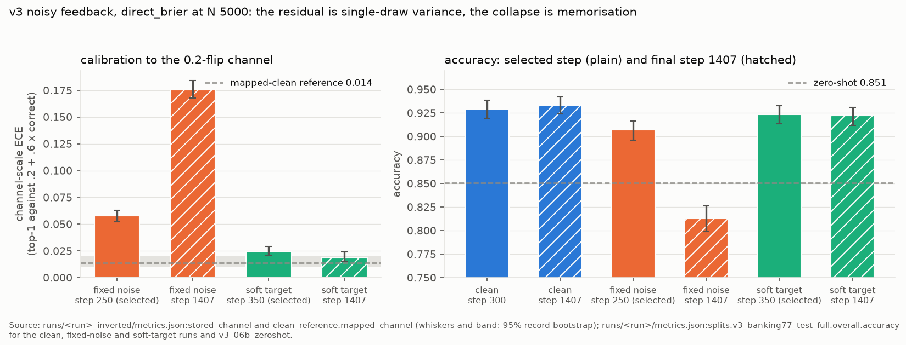
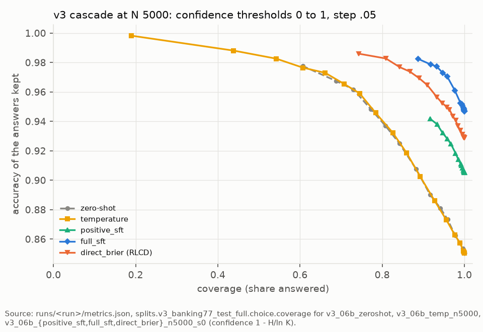

# jevmark v3 results: adaptation from deployment feedback

Every number cites the file it comes from, as `path:key`. Unless another file is named, numbers are from `runs/v3_stage_06b/metrics.json` (written by `scripts/compare_v3.py` at commit 83454a4, not dirty, regenerated at commit 9353145 with full_sft's seeds 1 and 2 added, at commit cd1217c with direct_brier plus a temperature added, and at commit 25d68e8 with the off-policy runs and direct_log's seeds of section 11 added; every earlier value is unchanged), shortened to `S:key`. Three more files are shortened the same way: `N:` for `runs/v3_noise_sweep_06b/metrics.json` (`scripts/compare_noise.py` at commit 36e8ee1, not dirty; the flip-rate sweep of section 4), `L:` for `runs/v3_stage_17b/metrics.json` (`scripts/compare_v3.py --size 17b` at commit 25d68e8, not dirty; section 12) and `P:` for `runs/paired_v3_17b_vs_06b/metrics.json` (`scripts/paired_deltas.py`, the same arm at both sizes; section 12). The v1 report (`docs/RESULTS_v1.md`, frozen, decision 49) and the v2 report (`docs/RESULTS_v2.md`) are the background this starts from.

## 1. Setup

**Question.** After deployment on a new domain, when the only feedback is whether the chosen action was right, does RLCD learn the domain faster, more accurately and better calibrated than what a practitioner would otherwise use?

**Domain.** The Banking77 train split, never trained on: 9942 messages after the duplicate rules (30 dropped as test matches, 31 as repeats; `data/v3_manifest.json`), each one choice question built as test_banking77 records are (gold, 8 distractors, `other`, seeded option order, 20 percent JSON states). Gold is always among the options, so `other` is never correct. Evaluation is on the full Banking77 test split, `v3_banking77_test_full` (3080 records, the 1000 test_banking77 records verbatim plus the other 2080), and, for forgetting, on test_indomain and test_unseen_intents. Data hashes are in `configs/v3_data.yaml`; every run's `metrics.json:data_files_sha256` matches them.

**The log.** sft_06b, unchanged, answered every log-domain message once in a fixed seeded order, sampling its action from q = 0.9 p + 0.1 / K; only the correctness of the chosen option was recorded, plus a copy flipped with probability 0.2 for the noisy condition.

| log | sha256 | policy accuracy | outcome rate | flip share | predicted `other` | source |
|---|---|---|---|---|---|---|
| seed 0 (main) | 847f44c4... | .836 | .739 | .202 | .059 | `runs/v3_log_s0/metrics.json` |
| seed 1 (logging variance) | 7c11c116... | .836 | .736 | .194 | .059 | `runs/v3_log_s1/metrics.json` |

Both logs were written at commit b5913ef, not dirty, by the sft_06b adapter (sha256 5d2681f3...). Policy accuracy is the argmax accuracy, identical for both seeds because p and the order are the same; the outcome rate is that of the sampled action.

**Learners.** All start from sft_06b and see the first N interactions of the seed 0 log, N in {500, 2000, 5000}:

1. **zero-shot:** sft_06b unchanged (`runs/v3_06b_zeroshot`). Its per-question probabilities equal `runs/sft_06b`'s on the three shared splits; test_banking77 accuracy .851 and ECE .067, as in v1 (`runs/v3_06b_zeroshot/metrics.json:splits.test_banking77.overall`).
2. **temperature:** one T fitted on the first 0.9 N logged outcomes by Bernoulli maximum likelihood of p(action): T 1.546, 1.522 and 1.453 at N 500, 2000 and 5000 (`runs/v3_06b_temp_n<N>/calibration.json`, `S:temperatures`).
3. **positive_sft:** cross-entropy on the logged action of the outcome-1 interactions (322, 1332 and 3342 of 450, 1800 and 4500; `runs/v3_06b_positive_sft_n<N>_s0/train_summary.json:n_used`).
4. **direct_brier (RLCD):** (r - p_a)^2 on the logged action's probability for every interaction, beta 0, no importance weights.
5. **full_sft:** cross-entropy on gold for every interaction, the upper bound.

**Budget rule.** Learners 3 to 5 run the same steps at each N: max(200, ceil(10 x 0.9 N / 32)), that is 200, 563 and 1407, warmup 20, linear decay, lr 5e-5, micro-batch 8 x 4 (`configs/v3_06b.yaml`). positive_sft makes more passes over fewer records.

**Selection rule.** Each learner trains on the first 0.9 N interactions and keeps the checkpoint (every 50 steps and the last; step 0 is not a candidate) with the highest mean Bernoulli log-likelihood of the logged outcomes under p(logged action) on the last 0.1 N. Gold is never used to select, not even by full_sft. Best steps: positive_sft 50, 50, 200; full_sft 50, 100, 300; direct_brier 50, 150, 300 at N 500, 2000, 5000 (`runs/<run>/train_summary.json:best_step`). Every learner peaked early and declined after. positive_sft's criterion never improved on step 0 at N 500 and 5000 (-.297 against -.279; -.363 against -.300), so its selected adapters are worse than sft_06b by the selection criterion: on confirmed answers alone it grows confident on its mistakes too.

**Runs.** 16 trained runs in four Kaggle sessions on one T4 at commit b5913ef (sessions A to D; D added full_sft's seeds 1 and 2), plus the soft-target run of section 4 and its step-1407 evaluation at commit 3d260cd, all not dirty, fp16 without fallback, every planned step run, each recording its log's sha256 and the sft_06b adapter's (`runs/v3_06b_*/metrics.json:git`, `:v3`, `:init_adapter_sha256`). A run of 1407 steps took 58.6 to 60.9 minutes and an evaluation 11.2 to 12.1 minutes.

**Intervals.** 95 percent bootstrap by record, 1000 resamples, the same record draws for every run on a split, so every difference is paired (`S:bootstrap`).

## 2. The N-curve on v3_banking77_test_full

`S:n_curve.<N>.<learner>`; direct_brier is seed 0.

| N | metric | zero-shot | temperature | positive_sft | full_sft | direct_brier |
|---|---|---|---|---|---|---|
| 500 | accuracy | .851 [.839, .863] | .851 | .886 [.874, .896] | .904 [.894, .914] | .888 [.877, .898] |
| 2000 | accuracy | .851 | .851 | .890 [.879, .901] | .924 [.915, .933] | .917 [.907, .926] |
| 5000 | accuracy | .851 | .851 | .905 [.896, .915] | .947 [.938, .955] | .929 [.920, .938] |
| 500 | ECE | .063 [.054, .074] | .023 [.021, .036] | .091 [.082, .102] | .043 [.035, .052] | .031 [.026, .044] |
| 2000 | ECE | .063 | .018 [.017, .032] | .082 [.072, .092] | .017 [.013, .027] | .022 [.017, .031] |
| 5000 | ECE | .063 | .020 [.016, .032] | .078 [.069, .087] | .030 [.024, .038] | .026 [.020, .034] |
| 500 | Brier | .229 | .219 | .200 | .149 | .173 [.159, .188] |
| 2000 | Brier | .229 | .219 | .185 | .114 | .127 [.113, .140] |
| 5000 | Brier | .229 | .219 | .169 | .082 | .111 [.098, .124] |
| 500 | NLL | .582 | .518 | .764 | .339 | .392 [.354, .430] |
| 2000 | NLL | .582 | .518 | .622 | .236 | .299 [.264, .332] |
| 5000 | NLL | .582 | .517 | .663 | .212 | .274 [.239, .311] |

Paired differences, direct_brier minus the other learner (`S:n_curve.<N>.direct_brier_minus_positive_sft`, `S:n_curve.<N>.direct_brier_minus_full_sft`):

| N | vs | accuracy | ECE | Brier | NLL |
|---|---|---|---|---|---|
| 500 | positive_sft | +.002 [-.006, +.009] | -.060 [-.066, -.048] | -.027 [-.037, -.018] | -.373 [-.426, -.319] |
| 2000 | positive_sft | +.027 [+.019, +.035] | -.060 [-.067, -.050] | -.058 [-.069, -.048] | -.323 [-.373, -.276] |
| 5000 | positive_sft | +.024 [+.016, +.031] | -.052 [-.060, -.043] | -.058 [-.069, -.046] | -.389 [-.443, -.333] |
| 500 | full_sft | -.017 [-.023, -.011] | -.011 [-.016, -.001] | +.024 [+.018, +.030] | +.052 [+.036, +.070] |
| 2000 | full_sft | -.007 [-.014, +.000] | +.005 [-.002, +.011] | +.013 [+.007, +.019] | +.062 [+.046, +.078] |
| 5000 | full_sft | -.018 [-.025, -.011] | -.004 [-.010, +.003] | +.029 [+.020, +.038] | +.062 [+.037, +.086] |

- **The temperature** changes no prediction, so its accuracy is zero-shot's at every N. It has the lowest or joint-lowest ECE at every N, but its Brier and NLL stay far above every trained learner's.
- **positive_sft** gains 3.5 to 5.4 points of accuracy and is the worst-calibrated learner at every N, with ECE and NLL above zero-shot's at every N.
- **direct_brier** ties positive_sft at N 500 and leads it by 2.4 to 2.7 points from N 2000, with ECE lower by .052 to .060 at every N. It stays 0.7 to 1.8 points below full_sft, at similar or lower ECE but higher Brier and NLL. It closes 69, 91 and 81 percent of the accuracy gap between zero-shot and full_sft at N 500, 2000 and 5000, computed from the stored accuracies (`S:n_curve.<N>.<learner>.accuracy`).

`figures/v3_n_curve.png`: accuracy and ECE against N for the five learners with their record-bootstrap intervals, and the range over training seeds 0, 1 and 2 at N 5000 for direct_brier and full_sft (`S:n_curve`, `S:seeds`).

## 3. Training seeds and logging variance at N 5000

direct_brier at N 5000: training seeds 0, 1 and 2 on the seed 0 log, and seed 0 on the seed 1 log (`S:seeds`).

| run | accuracy | ECE | Brier | NLL | minus seed 0, accuracy | minus seed 0, ECE |
|---|---|---|---|---|---|---|
| seed 0 | .929 [.920, .938] | .026 [.020, .034] | .111 | .274 | | |
| seed 1 | .935 [.926, .944] | .031 [.025, .040] | .105 | .274 | +.006 [+.001, +.011] | +.005 [-.001, +.011] |
| seed 2 | .930 [.921, .939] | .019 [.016, .029] | .111 | .274 | +.001 [-.004, +.007] | -.007 [-.012, +.000] |
| seed 1 log | .934 [.925, .943] | .026 [.022, .034] | .103 | .256 | +.005 [-.001, +.011] | +.000 [-.006, +.006] |
| mean of 3 training seeds (range) | .931 (.929, .935) | .025 (.019, .031) | .109 | .274 | | |

full_sft at N 5000, training seeds 0, 1 and 2 on the seed 0 log (session D, commit b5913ef; `S:seeds.full_sft`):

| run | accuracy | ECE | Brier | NLL | minus seed 0, accuracy | minus seed 0, ECE |
|---|---|---|---|---|---|---|
| seed 0 | .947 [.938, .955] | .030 [.024, .038] | .082 | .212 | | |
| seed 1 | .943 [.935, .951] | .020 [.016, .028] | .086 | .190 | -.004 [-.009, +.001] | -.010 [-.014, -.004] |
| seed 2 | .949 [.941, .956] | .016 [.013, .025] | .079 | .175 | +.002 [-.004, +.006] | -.014 [-.017, -.007] |
| mean of 3 training seeds (range) | .946 (.943, .949) | .022 (.017, .030) | .082 | .192 | | |

The training-seed mean against the other learners, each draw averaging the three seeds' differences under one record resample (decision 53; `S:seeds.training_seed_mean_minus_positive_sft`, `S:seeds.training_seed_mean_minus_full_sft`, `S:seeds.training_seed_mean_minus_full_sft_seed_mean`; positive_sft has seed 0 only):

| seed mean minus | accuracy | ECE | Brier | NLL |
|---|---|---|---|---|
| positive_sft | +.026 [+.019, +.033] | -.053 [-.059, -.044] | -.060 [-.071, -.048] | -.389 [-.443, -.333] |
| full_sft seed 0 | -.016 [-.022, -.010] | -.005 [-.009, +.001] | +.027 [+.018, +.036] | +.062 [+.040, +.084] |
| full_sft seed mean (seeds 0, 1, 2) | -.015 [-.020, -.010] | +.003 [-.001, +.008] | +.027 [+.020, +.034] | +.082 [+.061, +.101] |

- **Training seeds and the logging draw move accuracy less than record sampling does.** The seed range is .6 points and the seed 1 log moves accuracy by +.5 points, against a record-level half-width of about .9 points for one run. Only seed 1 against seed 0 is significant when paired, +.006 [+.001, +.011].
- **ECE varies across seeds about as much as one run's interval is wide**, for both learners (.019 to .031 for direct_brier, .017 to .030 for full_sft), so no ECE difference between them at N 5000 is called either way: the seed-mean difference is +.003 [-.001, +.008], and full_sft seed 0 alone had put it at -.005.
- **full_sft's seed 0 was representative for accuracy.** Its three seeds span .6 points (.943 to .949), like direct_brier's, and the gap of the two seed means, -.015 [-.020, -.010], is the single-seed -.016 to within a tenth of a point. Its NLL varies more across seeds (.175 to .212), which widens the NLL gap to +.082.
- **The conclusions against positive_sft and full_sft hold for the seed means**, with intervals that exclude 0. Unlike v2, where seed variance exceeded record-level intervals (docs/RESULTS_v2.md section 3), here seed 0 alone was representative.

**direct_brier plus a temperature.** One T per learner, fitted on CPU like the temperature learner by Bernoulli maximum likelihood of the logged outcomes, but under the learner's own probabilities on the 0.9 N interactions it trained on (`scripts/evaluate.py --log-prefix`, `scripts/calibrate.py --fit-log --fit-probs`; `runs/v3_06b_direct_brier_n<N>_s<k>_{prefix,temp}/`), comes out near 1: 1.019, .951 and 1.039 at N 500, 2000 and 5000, and 1.033 and .989 for seeds 1 and 2 (`S:direct_brier_temperatures`). It keeps direct_brier's accuracy (.888, .917, .929) and moves its ECE by -.002 [-.004, +.001], +.003 [-.002, +.007] and -.003 [-.005, +.001], to .030, .025 and .023 (`S:n_curve.<N>.direct_brier_temp`, `.direct_brier_temp_minus_direct_brier`); the three-seed mean moves by -.001 [-.003, +.000] (`S:seeds.direct_brier_temp_seed_mean_minus_direct_brier_seed_mean`). Against the temperature learner it is level on ECE, +.007, +.007 and +.003 with intervals containing 0, and 3.7 to 7.8 points ahead on accuracy (`.direct_brier_temp_minus_temperature`). The combination does give RLCD's accuracy at the temperature learner's ECE, but only because direct_brier already had that ECE: on its own training records it is close to calibrated (ECE .006 to .029, `runs/v3_06b_direct_brier_n<N>_s<k>_prefix/metrics.json:splits.v3_banking77_train.overall.ece`), so a temperature fitted there finds almost nothing to correct, and coverage at .80, .90 and .95 moves by at most 3 points either way (`S:coverage`). The prefix probabilities come from CPU fp32 and the test probabilities from the T4 fp16 evaluations, which differ by at most about 1e-2 per probability (API_SPEC section 1).

## 4. Noisy feedback: the channel, the residual and the collapse

The noisy condition trains on outcomes flipped with probability 0.2, for direct_brier and positive_sft at N 5000 (`S:noisy`); the same comparison at flip rates 0.1 and 0.3 follows under **Other flip rates**. Both runs read the flipped column for training and selection: 2886 positives in the first 4500 interactions and a selection outcome rate of .638, against 3342 and .750 clean (`runs/v3_06b_positive_sft_n5000_s0_noisy/train_summary.json:n_used`, `:init_select`).

| learner | clean accuracy | noisy accuracy | noisy minus clean | clean ECE | noisy ECE | noisy minus clean |
|---|---|---|---|---|---|---|
| direct_brier | .929 | .907 [.897, .916] | -.022 [-.030, -.014] | .026 | .164 [.157, .173] | +.138 [+.123, +.151] |
| positive_sft | .905 | .866 [.855, .878] | -.039 [-.048, -.031] | .078 | .050 [.040, .060] | -.029 [-.037, -.021] |

direct_brier's change minus positive_sft's change (`S:noisy.direct_brier_change_minus_positive_sft_change`): accuracy +.017 [+.007, +.028], ECE +.167 [+.151, +.182], Brier +.013 [+.000, +.025], NLL +.277 [+.233, +.320]. In absolute terms noisy direct_brier is still the better of the two: accuracy .907 against .866, Brier .174 against .219, NLL .460 against .573 (`S:noisy.<arm>.noisy`).

**The channel.** A proper score is minimised by the probability of the variable it is scored against. direct_brier scores p(action) against the revealed outcome, so it learns P(revealed outcome = 1 | action). Under a symmetric flip at rate f that is (1 - f) for a correct action and f for a wrong one, so p = f + (1 - 2f) P(correct): the model is calibrated to the channel, not to correctness, and its confidence lives on [.2, .8]. That is why its stored ECE against correctness is .164 and almost no answer reaches a coverage threshold of .80 (section 6). On average the selected noisy run (step 250) sits near the channel line: mean top-1 .743 against .2 + .6 x .907 = .744 (`runs/v3_06b_direct_brier_n5000_s0_noisy_inverted/metrics.json:stored_channel.mean_confidence`, `:stored_channel.mean_channel_outcome`). Across the three rates of the sweep below it stays near the line, within .03, above it at 0.1 and 0.3, so the close match at 0.2 is partly chance. A known flip rate is invertible, p_correct = (p - f) / (1 - 2f).

**Two scales.** Calibration is compared here on the channel scale: ECE of the stored top-1 probability against the channel outcome of the top option, .2 + .6 x correct, with the same 15 bins (`scripts/invert_noisy.py`, decision 59). Its reference is the mapped-clean run: the clean run's top-1 passed through .2 + .6 p and scored the same way, what a channel-calibrated copy of the clean run would score, .014 [.011, .019] (`:clean_reference.mapped_channel`). The linear map shrinks every calibration gap by 1 - 2f = .6, so comparing a noisy run with the clean run's own .026 would flatter it. The per-option inversion (clip to [0, 1], renormalise) is kept as the distribution a caller would receive, but it overshoots: when every non-top option is below .2 they all clip to 0 and the top becomes 1 (inverted mean top-1 .972, gold clipped to 0 on 184 questions, `:inverted`, `:questions_gold_clipped_to_zero`). An earlier reading of this section (decision 57) took the inverted top-1 of .861 against .907 accuracy as underconfidence and attributed the residual partly to under-convergence; the first came from clipping at 1 and the second is refuted below (decision 59).

**Other flip rates.** The flips are redrawn at 0.1 and 0.3 from the same seeded stream as the 0.2 log, one draw per interaction, so the three logs are nested: an interaction flipped at 0.1 is flipped at 0.2 and 0.3 too, and the rates are paired comparisons (`scripts/derive_flip_log.py`; `runs/v3_log_s0_flip{0.1,0.3}/metrics.json`, flip shares .105 and .298 over the whole log; redrawing at 0.2 reproduces the seed 0 log byte for byte). direct_brier and positive_sft trained at N 5000, seed 0, on each sibling log at commit 36e8ee1, not dirty, fp16 without fallback, and direct_brier's step-1407 adapter was evaluated as well. Everything is scored as at 0.2: the channel line is f + (1 - 2f) x accuracy, channel-scale ECE scores the stored top-1 against f + (1 - 2f) x correct, the reference is the clean run of the same learner mapped through f + (1 - 2f) p, and the inverted top-1 is (top-1 - f) / (1 - 2f), clipped (`N:by_rate.<f>.<arm>`, `N:clean.<arm>`).

direct_brier:

| f | accuracy | minus clean | stored ECE | channel-scale ECE | reference | inverted top-1 ECE | mean top-1 | channel line | step 1407 accuracy | criterion growth after the best step |
|---|---|---|---|---|---|---|---|---|---|---|
| 0 (clean) | .929 | | .026 | | | | | | .933 | .059 |
| 0.1 | .923 [.914, .932] | -.006 [-.013, +.001] | .059 | .038 [.035, .046] | .021 | .020 [.017, .030] | .870 | .838 | .892 | .114 |
| 0.2 | .907 [.897, .916] | -.022 [-.030, -.014] | .164 | .058 [.052, .063] | .014 | .051 [.042, .059] | .743 | .744 | .813 | .284 |
| 0.3 | .888 [.877, .898] | -.041 [-.050, -.032] | .214 | .069 [.065, .073] | .009 | .068 [.058, .078] | .674 | .655 | .734 | .757 |

positive_sft:

| f | accuracy | minus clean | stored ECE | channel-scale ECE | reference | inverted top-1 ECE | mean top-1 | channel line | criterion growth after the best step |
|---|---|---|---|---|---|---|---|---|---|
| 0 (clean) | .905 | | .078 | | | | | | .268 |
| 0.1 | .890 [.880, .901] | -.015 [-.021, -.008] | .046 | .124 [.118, .133] | .063 | .071 [.062, .082] | .935 | .812 | 1.244 |
| 0.2 | .866 [.855, .878] | -.039 [-.048, -.031] | .050 | .196 [.190, .203] | .047 | .105 [.095, .117] | .915 | .720 | 2.216 |
| 0.3 | .867 [.856, .879] | -.038 [-.046, -.030] | .043 | .251 [.247, .256] | .031 | .097 [.087, .109] | .896 | .647 | 2.916 |

Sources: accuracy and stored ECE `N:by_rate.<f>.<arm>.{accuracy,ece}`; minus clean `.minus_clean`; channel-scale ECE, reference, mean top-1 and channel line `.channel.channel_scale`; inverted top-1 ECE `.channel.inverted_top1_ece`; step 1407 `.last.accuracy`; criterion growth `.selection.growth`, the excess of the selection criterion over its floor -H(f) at step 1407 minus the same at the selected step (`N:clean.<arm>.selection.growth` for the clean rows). Selected steps: direct_brier 300, 450, 250, 250 and positive_sft 200, 100, 250, 100 for clean, 0.1, 0.2, 0.3 (`.selection.best_step`).

direct_brier's accuracy loss from clean minus positive_sft's, positive when direct_brier loses less (`N:by_rate.<f>.direct_brier_loss_minus_positive_sft_loss.accuracy`): +.009 [+.000, +.018] at 0.1, +.017 [+.007, +.028] at 0.2, -.003 [-.014, +.007] at 0.3.

The predictions for the sweep, stated before it ran:
1. *direct_brier sits on the channel line at every f.* Near it, not on it: mean top-1 minus the line is +.031, -.001 and +.019 (`.channel.channel_scale.mean_top1_minus_channel_line`). At 0.1 and 0.3 the selected adapter is more confident than the channel, and its channel-scale ECE exceeds the reference by .017, .044 and .060 as f grows.
2. *Its accuracy loss grows with f but stays below positive_sft's at every f.* The loss grows: -.006 (interval including 0), -.022, -.041. It stays below positive_sft's at 0.1 (interval reaching 0) and 0.2, and fails at 0.3, where the two losses are level (-.041 against -.038). direct_brier is still the more accurate learner at every rate (.923 against .890, .907 against .866, .888 against .867, from the stored accuracies), because it starts 2.4 points higher, but at 0.3 its stored Brier and NLL are worse than positive_sft's (.232 against .205, .577 against .502; `.brier`, `.nll`). One training seed at each rate.
3. *The collapse at step 1407 grows with f.* Held: the step-1407 adapter is -.031 [-.039, -.023], -.094 [-.106, -.083] and -.154 [-.168, -.139] below the selected one (`.last.minus_selected.accuracy`), against +.004 for the clean run, and the criterion's growth after the best step is .114, .284 and .757. At 0.3 the step-1407 adapter (.734) is 12 points below zero-shot (.851, `N:zero_shot.accuracy`); every selected adapter is above zero-shot.
4. *At 0.3 the inversion's amplification, 1 / (1 - 2f) = 2.5 (`N:by_rate.0.3.amplification`), makes the inverted ECE worse than at 0.2 even with similar channel-scale ECE.* Held, with overlapping intervals: inverted top-1 ECE .068 [.058, .078] against .051 [.042, .059], channel-scale ECE .069 against .058.

- **At 0.1 the noise costs direct_brier almost nothing:** -.006 in accuracy with an interval including 0, and an inverted top-1 ECE of .020 [.017, .030], level with the clean run's stored .026.
- **positive_sft is no worse at 0.3 than at 0.2** (.867 against .866). It selected step 100 at 0.3 against 250 at 0.2, stopping closer to its start, and its criterion degrades after the best step four to eleven times as much as direct_brier's (1.244, 2.216, 2.916 against .114, .284, .757); early stopping protects it, not its objective.
- **positive_sft's stored ECE improves under noise** (.043 to .050 against .078 clean): the flipped positives include wrong actions, which soften its overconfidence. It is not calibrated to the channel: its mean top-1 is .12 to .25 above the line.
- **Noisier targets move the model less on the old domains:** direct_brier's in-domain accuracy minus zero-shot is -.026, -.014 and -.010 at 0.1, 0.2 and 0.3, against -.027 clean (`runs/v3_06b_direct_brier_n5000_s0_noisy{_flip0.1,,_flip0.3}/metrics.json:splits.test_indomain.overall.accuracy` minus zero-shot's .956, point differences).
- **Coverage follows the channel:** the stored direct_brier probabilities keep .509 of answers at .80 at 0.1 and .002 at 0.3; inverted, .883 at .95 (accuracy of those kept .967) at 0.1 and .922 (.915) at 0.3 (`runs/v3_06b_direct_brier_n5000_s0_noisy_flip<f>_inverted/metrics.json:stored.coverage`, `:inverted.coverage`). The inversion clips gold to 0 on 124 and 251 questions (`:questions_gold_clipped_to_zero`), so the inverted NLL (1.2 and 2.3) is not a usable number.

**Two diagnostics** (decision 59). V-a evaluates the clean run's final adapter (step 1407) as a control for the fixed-noise run's final adapter. V-b trains direct_brier on the expected flipped outcome, .8 for a correct logged action and .2 otherwise (`--noise soft`), the infinite-draw limit: it needs the clean outcome, an oracle input, so it is a diagnostic and not a learner. It selects on the stored flipped outcomes exactly as the fixed-noise run does, and its configuration is otherwise identical (run at commit 3d260cd; the log-mode code is otherwise unchanged from b5913ef). Six adapters of direct_brier at N 5000, seed 0, seed 0 log, on v3_banking77_test_full:

| | clean, step 300 (selected) | clean, step 1407 | fixed noise, step 250 (selected) | fixed noise, step 1407 | soft target, step 350 (selected) | soft target, step 1407 |
|---|---|---|---|---|---|---|
| accuracy | .929 [.919, .938] | .933 [.924, .942] | .907 [.896, .916] | .813 [.799, .826] | .923 [.913, .932] | .922 [.912, .931] |
| channel-scale ECE | reference .014 [.011, .019] | | .058 [.052, .063] | .176 [.168, .184] | .024 [.021, .029] | .019 [.015, .024] |
| stored ECE | .026 | .045 | .164 | .053 | .182 | .174 |
| Brier | .111 | .111 | .174 | .304 | .155 | .153 |
| NLL | .274 | .308 | .460 | .787 | .435 | .426 |
| mean top-1 | .951 | .975 | .743 | .861 | .742 | .749 |
| predicted `other` | .000 | .000 | .007 | .043 | .005 | .007 |
| coverage at .80 / .90 / .95 (accuracy) | .868 (.974) / .809 (.983) / .743 (.986) | .937 (.960) / .906 (.970) / .874 (.977) | .032 (1.000) / .000 / .000 | .567 (.893) / .278 (.908) / .087 (.921) | .000 / .000 / .000 | .000 / .000 / .000 |
| test_indomain, accuracy / ECE minus zero-shot | -.027 / -.001 | -.051 / +.020 | -.014 / +.050 | -.042 / +.019 | -.013 / +.068 | -.017 / +.076 |
| test_unseen_intents, accuracy / ECE minus zero-shot | +.025 / -.031 | +.013 / -.014 | +.018 / -.018 | -.015 / -.017 | +.017 / +.004 | +.009 / +.020 |
| selection criterion, excess over its floor | .103 | .162 | .065 | .349 | .046 | .049 |

Sources. Runs, in column order: `runs/v3_06b_direct_brier_n5000_s0`, `runs/v3_06b_direct_brier_n5000_s0_last`, `runs/v3_06b_direct_brier_n5000_s0_noisy`, `runs/v3_06b_direct_brier_n5000_s0_noisy_last`, `runs/v3_06b_direct_brier_n5000_s0_noisy_soft`, `runs/v3_06b_direct_brier_n5000_s0_noisy_soft_last`. Accuracy, stored ECE, Brier and NLL: `<run>/metrics.json:splits.v3_banking77_test_full.overall`; predicted `other` and coverage (the response confidence field, 1 - H / ln K): `:splits.v3_banking77_test_full.choice.by_gold_other.predicted_other_rate`, `:choice.coverage`; mean top-1: `<run>_inverted/metrics.json:stored.mean_top1` for the noisy and soft columns, the count-weighted mean confidence of `<run>/metrics.json:splits.v3_banking77_test_full.overall.reliability` for the clean columns; channel-scale ECE: `<run>_inverted/metrics.json:stored_channel` (written by the same `invert_noisy.py`, at commit 82e6c44 for the fixed-noise runs and 3d260cd for the soft runs, not dirty), the reference `:clean_reference.mapped_channel`; forgetting: `<run>/metrics.json:splits.<split>.overall` minus `runs/v3_06b_zeroshot/metrics.json`, point differences without an interval; the selection criterion: `train_summary.json:selection_curve` of the source run at the selected step and at step 1407, as the excess over the best achievable value, 0 for clean outcomes and H(0.2) = .500 for the flipped ones. The `_last` runs were evaluated from `adapter_last` by `scripts/prepare_adapter_run.py`, with the adapter sha256 recorded in `config.yaml:adapter_eval`.

`figures/v3_noise.png`: the table above in two panels, channel-scale ECE against the mapped-clean reference (band: its 95 percent interval) and accuracy against zero-shot, selected steps plain and step 1407 hatched.

**Decision 59's predictions.**
1. *The soft run's selected adapter has channel-scale ECE within .01 of the mapped-clean reference.* Fails by .0005 at the selected step: .024 against .014, a gap of .0105, with intervals [.021, .029] and [.011, .019]. It holds at step 1407: .019, a gap of .005. Between steps 200 and 1407 the soft run's selection criterion stays within .004 of its mean (spread .007), so the selected step is close to arbitrary, and the step-350 gap is better read as selection noise than as a limit of the objective. Measured against the fixed-noise selected run's excess over the reference (.058 - .014 = .044), the soft target removes 77 percent at its selected step and 89 percent at step 1407.
2. *The soft run's step-1407 accuracy is within .01 of its selected adapter's, and the criterion's excess over its floor grows by less than .10 after the best step.* Holds: .922 against .923 (-.001), and +.003, against +.284 for the fixed-noise run and +.059 for the clean run.
3. *The selected accuracy against .907 and .929.* .923 is 1.6 points above the fixed-noise run's .907 and 0.6 below the clean .929, so about three quarters of the fixed-noise run's 2.2-point loss at step 250 is also a variance effect; the rest is consistent with soft targets sharpening less than clean ones.

V-c, a per-epoch redraw of the flip, was designed but not run (decision 59): a finite number of redraws would be expected to land between the fixed-draw and soft results, it needs the same oracle input, and like V-b it would not separate "no fixed draw to memorise" from "more information per interaction".

**What the residual and the collapse are.**
- **The residual is single-draw variance, not a limit of the objective and not under-convergence.** With the sampling variance removed and nothing else changed, channel-scale ECE falls from .058 to .019 to .024, near the .014 that a channel-calibrated copy of the clean run would score, and the inverted top-1 ECE reaches .017 to .031 against the clean run's .026 (`runs/v3_06b_direct_brier_n5000_s0_noisy_soft{,_last}_inverted/metrics.json:inverted_top1_only`). The target compression is not the problem: a correct action's .8 and a wrong one's .2 are both reachable under the sum-to-one constraint. The soft target also supplies the exact expected outcome, so this reading shares the information caveat stated for the collapse below: it does not separate the removed sampling variance from the extra information per interaction.
- **The collapse is memorisation of fixed draws.** Trained to step 1407, the fixed-noise run falls to .813 (`runs/v3_06b_direct_brier_n5000_s0_noisy_last/metrics.json:splits.v3_banking77_test_full.overall.accuracy`), below zero-shot's .851 (`runs/v3_06b_zeroshot/metrics.json:splits.v3_banking77_test_full.overall.accuracy`), while the clean run keeps .933 and the soft run .922 over the same steps. This reading rests on three pieces of evidence together: the fixed-noise criterion degrading after its best step (+.284) while the soft one stays flat (+.003); the clean control not collapsing (+.059, accuracy kept); and the fixed-noise run's predicted-`other` rate rising from .007 to .043, which a correct answer marked wrong would push it towards. Isolating memorisation from the extra information a soft target gives would need fixed noise without repeated passes, which needs a larger log and is out of scope.
- **Early stopping on feedback is essential, and it worked.** The feedback-only criterion picked step 250, before the collapse, without reading gold.
- **The inversion needs the noise rate and applies everywhere.** The learned compression towards the channel scale is global: the soft run's in-domain ECE rises by .068 to .076 against zero-shot, and the fixed-noise run's by .050, so a caller would invert every answer, not only those on the adapted domain, and needs f to do it.

The inversion diagnostic for both noisy learners, on the stored and the inverted distributions:

| run on v3_banking77_test_full | ECE | Brier | NLL | mean top-1 | coverage at .80 / .90 / .95 (accuracy) |
|---|---|---|---|---|---|
| direct_brier noisy, stored | .164 [.156, .174] | .174 | .460 | .743 | .032 (1.000) / .000 / .000 |
| direct_brier noisy, inverted | .066 [.057, .076] | .160 | 1.722 | .972 | .931 (.935) / .901 (.942) / .892 (.946) |
| direct_brier noisy, inverted top-1 only | .051 [.042, .059] | | | .861 | |
| direct_brier clean | .026 [.020, .035] | .111 | .274 | .951 | .868 (.974) / .809 (.983) / .743 (.986) |
| positive_sft noisy, stored | .050 [.040, .060] | .219 | .573 | .915 | .794 (.944) / .311 (.971) / .042 (.953) |
| positive_sft noisy, inverted | .121 [.109, .132] | .253 | 3.283 | .987 | .969 (.882) / .956 (.888) / .951 (.889) |
| positive_sft noisy, inverted top-1 only | .105 [.095, .117] | | | .969 | |
| positive_sft clean | .078 [.069, .089] | .169 | .663 | .984 | .958 (.928) / .933 (.938) / .916 (.942) |

Sources: `runs/v3_06b_<arm>_n5000_s0_noisy_inverted/metrics.json:{stored,inverted,inverted_top1_only,clean_reference}`. The same inversion makes positive_sft worse (.050 to .121), as it should: positive_sft models no outcome rate, so it has no channel calibration to undo, and its stored ECE improved under noise only because false positives softened it.

Under feedback flipped at a known rate, RLCD's proper score does what it should: it calibrates to the channel it is shown, and inverting the rate brings it back to correctness. What is left over in a real log comes from having only one noisy draw per interaction, and the same single draw is what the learner memorises when it passes over the log too often, falling below zero-shot by step 1407. Selecting the checkpoint on the logged feedback alone stopped it in time, so the method is usable under noise when the flip rate is known and early stopping is kept; neither holds by default in a real deployment, where the noise rate is unknown and the channel compression would apply to every answer the model gives. Over flip rates 0.1, 0.2 and 0.3 the picture is the same, with the losses and the collapse growing with f; RLCD's smaller accuracy loss than positive-only SFT holds at 0.1 and 0.2 and is gone at 0.3, on one seed per rate.

## 5. Forgetting

Accuracy and ECE minus zero-shot on test_indomain (zero-shot .956, ECE .013) and test_unseen_intents (zero-shot .892, ECE .068), paired (`S:forgetting.<split>.minus_zero_shot.<run>`).

| run | test_indomain accuracy | test_indomain ECE | test_unseen_intents accuracy | test_unseen_intents ECE |
|---|---|---|---|---|
| temperature n500 / n2000 / n5000 | .000 | +.006 / +.005 / -.000 | .000 | -.033 / -.031 / -.026 |
| positive_sft n500 | -.007 [-.010, -.005] | +.019 | +.016 | +.007 |
| positive_sft n2000 | -.007 [-.009, -.005] | +.017 | +.021 | -.003 |
| positive_sft n5000 | -.008 [-.011, -.006] | +.017 | +.020 | +.001 |
| direct_brier n500 | -.005 [-.008, -.003] | -.002 | +.017 | -.025 |
| direct_brier n2000 | -.017 [-.020, -.013] | -.002 | +.023 | -.036 |
| direct_brier n5000 seed 0 | -.027 [-.031, -.023] | -.001 | +.025 | -.031 |
| direct_brier n5000 seed 1 | -.043 [-.048, -.039] | +.010 | +.020 | -.026 |
| direct_brier n5000 seed 2 | -.029 [-.033, -.025] | +.001 | +.026 | -.032 |
| direct_brier n5000 seed 1 log | -.030 [-.034, -.026] | +.008 | +.025 | -.034 |
| full_sft n500 | -.019 [-.022, -.016] | +.009 | +.030 | -.026 |
| full_sft n2000 | -.025 [-.029, -.021] | +.008 | +.029 | -.029 |
| full_sft n5000 seed 0 | -.052 [-.057, -.047] | +.043 [+.038, +.047] | +.022 | -.007 |
| full_sft n5000 seed 1 | -.036 [-.040, -.032] | +.015 | +.027 | -.026 |
| full_sft n5000 seed 2 | -.050 [-.054, -.045] | +.025 | +.020 | -.020 |
| direct_brier n5000 noisy | -.014 [-.017, -.011] | +.050 | +.018 | -.018 |
| positive_sft n5000 noisy | -.008 [-.010, -.005] | +.005 | +.004 | -.001 |

- **Every trained learner loses in-domain accuracy and gains on the unseen intents**, which share the CLINC format but not the label set: all 21 trained learners in `S:forgetting.<split>.minus_zero_shot` (the temperature learner changes no prediction, so its accuracy difference is 0).
- **The in-domain cost grows with N for direct_brier and full_sft**, up to 2.7 to 4.3 points for direct_brier at N 5000 across seeds and 3.6 to 5.2 points for full_sft. positive_sft costs under 1 point at every N. The clean direct_brier runs keep in-domain ECE within .010 of zero-shot; full_sft at N 5000 adds .015 to .043.
- **Forgetting varies more across seeds than Banking77 accuracy does:** -.027, -.043 and -.029 for direct_brier's three training seeds and -.052, -.036 and -.050 for full_sft's, ranges of 1.6 points each against .6 on Banking77. Beta 0 is a choice, and this is its cost.

## 6. Predicted `other` and coverage

**`other` is never correct here**, so negative feedback can teach "never answer other" directly. The predicted-`other` rate on v3_banking77_test_full, and accuracy on the 2899 questions where no run predicted `other` (`S:other`):

| run | predicted `other` | accuracy without `other` |
|---|---|---|
| zero-shot and temperature | .052 | .901 |
| positive_sft n500 / n2000 / n5000 | .012 / .011 / .007 | .914 / .915 / .928 |
| direct_brier n500 / n2000 / n5000 | .006 / .000 / .000 | .910 / .934 / .941 |
| direct_brier n5000 seed 1 / seed 2 / seed 1 log | .000 / .000 / .000 | .944 / .943 / .945 |
| full_sft n500 / n2000 / n5000 | .002 / .001 / .000 | .920 / .934 / .954 |
| direct_brier noisy / positive_sft noisy | .007 / .040 | .926 / .908 |

Every trained learner nearly stops answering `other`, and that alone is worth about 5 points of the zero-shot error. On the questions where nobody answers `other`, direct_brier still leads positive_sft by 1.9 and 1.3 points at N 2000 and 5000 and trails full_sft by 0.0 and 1.3, so its gains are not only the `other` effect. These subset numbers have no interval.

**Coverage** at confidence thresholds .80, .90 and .95, using the response confidence field (1 - H / ln K), not the top-1 probability that ECE uses; accuracy of the kept answers in brackets (`S:coverage.<run>`):

| run | .80 | .90 | .95 |
|---|---|---|---|
| zero-shot | .772 (.948) | .688 (.967) | .607 (.978) |
| temperature n500 / n5000 | .563 (.981) / .607 (.976) | .347 (.990) / .438 (.988) | .080 (.996) / .189 (.998) |
| positive_sft n500 | .940 (.917) | .919 (.928) | .902 (.933) |
| positive_sft n5000 | .958 (.928) | .933 (.938) | .916 (.942) |
| direct_brier n500 | .779 (.968) | .686 (.981) | .594 (.991) |
| direct_brier n2000 | .818 (.976) | .742 (.985) | .649 (.990) |
| direct_brier n5000 seed 0 | .868 (.974) | .809 (.983) | .743 (.986) |
| full_sft n500 | .857 (.958) | .784 (.974) | .719 (.985) |
| full_sft n5000 | .947 (.973) | .918 (.979) | .888 (.982) |

positive_sft keeps over 90 percent of answers at the .95 threshold with 93 to 94 percent accuracy among them, the overconfidence of prediction 2 in a form a cascade would feel: it would pass on about 6 percent errors as confident. direct_brier keeps fewer answers at every threshold than full_sft at the same N, at similar accuracy among those kept. The temperature keeps the fewest.

`figures/v3_coverage.png`: the full coverage curve at N 5000 behind the table above, thresholds 0 to 1 in steps of .05 (`<run>/metrics.json:splits.v3_banking77_test_full.choice.coverage` for v3_06b_zeroshot, v3_06b_temp_n5000 and the three trained learners at seed 0).

## 7. The B2 reference

gpt-4.1-mini (B2) exists only on the 500-record subset of test_banking77: accuracy .918, ECE .035 (`S:b2_reference.b2`). The learners on the same 500 records (`S:b2_reference.runs`):

| run | accuracy | ECE |
|---|---|---|
| zero-shot | .846 | .078 |
| temperature n500 / n5000 | .846 / .846 | .048 / .041 |
| positive_sft n500 / n2000 / n5000 | .884 / .886 / .916 | .093 / .086 / .070 |
| direct_brier n500 / n2000 / n5000 seed 0 | .888 / .910 / .934 | .038 / .028 / .034 |
| direct_brier n5000 seed 1 / seed 2 / seed 1 log | .936 / .926 / .934 | .036 / .029 / .031 |
| full_sft n500 / n2000 / n5000 seed 0 | .904 / .916 / .948 | .050 / .031 / .032 |
| full_sft n5000 seed 1 / seed 2 | .944 / .950 | .024 / .030 |

From N 5000, every direct_brier run is above gpt-4.1-mini's .918 on this subset, from 5000 logged correctness bits and no labels; positive_sft reaches .916 and full_sft .948. With 500 records, a 1.6-point difference is within sampling error, and these rows have no paired interval against B2.

## 8. The four predictions

The predictions as stated before the runs, each with its verdict.

1. **"RLCD beats positive-only SFT in accuracy at every N, because it uses negative feedback."** Not held at every N: a tie at N 500, +.002 [-.006, +.009]; held from N 2000, +.027 [+.019, +.035] at N 2000 and +.024 [+.016, +.031] at N 5000, +.026 [+.019, +.033] for the three-seed mean (section 2, section 3). The design stated before the runs that if prediction 1 failed, v2 and v3 together are a complete negative result about RLCD as reconstructed. It fails only at the smallest N and by a tie, and holds clearly from N 2000, so v3 is not that complete negative result: with 1800 or more logged interactions, negative feedback adds 2.4 to 2.7 points over discarding it.
2. **"RLCD's ECE is lower than positive-only SFT's, which only ever sees confirmed answers and should be overconfident."** Held at every N: -.060 [-.066, -.048], -.060 [-.067, -.050] and -.052 [-.060, -.043], with Brier and NLL agreeing; positive_sft is the worst-calibrated learner at every N, and its coverage at .95 keeps 90 percent of answers at 93 to 94 percent accuracy (sections 2 and 6).
3. **"RLCD approaches full-label SFT as N grows; the gap at N 5000 is the price of not having labels."** Failed: the accuracy gap is -.017 [-.023, -.011], -.007 [-.014, +.000] and -.018 [-.025, -.011] at N 500, 2000 and 5000; it does not shrink with N. With both learners on three training seeds, the price of not having labels at N 5000 is 1.5 points of accuracy, direct_brier's seed mean minus full_sft's, -.015 [-.020, -.010], with ECE level, +.003 [-.001, +.008], and higher Brier and NLL, +.027 [+.020, +.034] and +.082 [+.061, +.101] (section 3); full_sft's seed 0 alone had given -.016, so the verdict does not depend on it.
4. **"Under noisy feedback, RLCD degrades less than positive-only SFT."** Held for accuracy, failed for calibration. Accuracy: direct_brier loses 2.2 points and positive_sft 3.9, a difference of +.017 [+.007, +.028]. Calibration: direct_brier's ECE rises by .138 while positive_sft's falls by .029, a difference of +.167 [+.151, +.182], with NLL +.277 [+.233, +.320] and Brier +.013 [+.000, +.025]. As stored, the calibration failure is the proper score calibrating to the noisy outcome it was given: the selected run sits near the channel line on average (mean top-1 .743 against .744; within .03 of it at 0.1 and 0.3), and its channel-scale ECE is .058 against a mapped-clean reference of .014. That remainder is single-draw variance in a one-draw log, not a limit of the objective: with the variance removed it falls to .019 to .024 (section 4, decision 59). At the other rates of section 4 the accuracy half holds at 0.1, +.009 [+.000, +.018], and fails at 0.3, -.003 [-.014, +.007], one seed per rate.

## 9. Limitations

- **One domain.** Banking77 only, with 10 options and gold always present, so `other` is never right and "never answer other" is free to learn; other domains, other option counts or a gold-absent construction may differ.
- **One logging policy.** sft_06b at epsilon 0.1, already .836 accurate on the log domain (`runs/v3_log_s0/metrics.json:accuracy`); a weaker or more exploratory policy changes how many negatives there are and which ones.
- **A simulated feedback channel.** Outcomes come from gold labels, revealed perfectly or flipped symmetrically at a known rate; real deployment feedback is delayed, biased towards some errors and of unknown noise rate, which the inversion needs.
- **Two sizes, one seed at the larger.** 0.6B for everything; 1.7B for the N 5000 comparison of three learners, on one training seed and one log (section 12).
- **The checkpoint grid.** Checkpoints are every 50 steps. At N 2000 direct_log and ips_log peaked at step 50, the first candidate, so a finer grid could favour the log-score arms there (section 11).
- **The noise sweep has one seed per rate.** The rates are paired through nested flips, which makes the trends over f firmer than independent draws would, but the learner comparison at a given rate carries training-seed variance (section 4).
- **positive_sft has one seed.** Its side of every comparison carries no seed variance; direct_brier's and full_sft's three seeds each span .6 points on Banking77 accuracy, which suggests it is small. full_sft was run on three seeds at N 5000 (section 3); at N 500 and 2000 every learner has seed 0 only.
- **Forgetting varies by seed** (-.027 to -.043 in-domain for direct_brier at N 5000), more than the Banking77 result does, and beta 0 leaves it unconstrained.
- **Selection on the log's last 0.1 N** chose early steps for every learner; a different selection slice or rule could change the ranking at N 500, where 50 interactions select.
- **Banking77's labels are noisy** (`docs/audit/summary.json`, `docs/audit/SUMMARY.md`). Two language-model judges, no human, read 200 questions blind to the model answers. On 50 questions drawn uniformly from v3_banking77_test_full, they find some label problem in 12 and 14 percent (`groups.b.{first,second}.any_label_problem`, intervals .06 to .26) and a clearly wrong label in 4 percent each (two rows, interval .01 to .13); the rest of the problems are ambiguous or follow an annotation convention the option descriptions do not state. That puts the ceiling a perfect reader could score near .96, with full_sft's seed mean already at .946, so part of the remaining error of every learner is not model error. The clean feedback inherits these labels: its outcomes are not noise-free, and the noise they carry is concentrated on particular intents and phrasings rather than random like the 0.2 flip of section 4. Of the 127 questions both full_sft and direct_brier miss at N 5000, the judges find a label problem in about six in ten (.66 and .62 on 100 of them, 56 rows by both; `groups.a`), about 2.3 to 2.7 points of each learner's error. Agreement between the judges is .82 (Cohen's kappa .66); they agree that a label has a problem far more often than on which kind. The audit says nothing about the gap between direct_brier and full_sft: it lies in the questions on which they disagree, which neither sample targets.

## 10. What v3 shows and what it does not

v3 shows that when a deployed model sees only the correctness of its own actions on a new domain, training on that signal with a pathwise Brier loss beats discarding the failures, by 2.4 to 2.7 points of accuracy from 2000 logged interactions and by about .05 to .06 ECE at every N, and that it closes 69 to 91 percent of the accuracy gap between zero-shot and full-label SFT. It does not show that RLCD approaches full labels as feedback grows, since the 1.5-point gap at N 5000 (seed means of both) is no smaller than at N 500, and it does not show calibration robust to noisy feedback, where a proper score calibrates to the channel and needs a known noise rate to be undone. Together with v2, the claim that survives is narrow: RLCD adds value over positive-only SFT when the only feedback is partial, and nowhere else that was tested.

Phase 4 adds three checks (sections 4, 11 and 12), and they leave that claim standing. Importance weighting adds nothing on this log, and a log score in place of the Brier score is a choice within the same pathwise family, with a small lead on Brier and NLL and more in-domain forgetting. At 1.7B the ordering holds and direct_brier comes within .4 points of full-label SFT, with an interval covering 0, on one seed. Under noise, RLCD's smaller accuracy loss than positive-only SFT holds at flip rates 0.1 and 0.2 and is gone at 0.3.

## 11. Off-policy baselines

**Question.** A reader from contextual bandits expects importance weighting and a policy-gradient baseline next to the pathwise Brier objective. Does direct_brier's lead over positive_sft survive them, and does any of them beat direct_brier?

**Arms.** Four more learners on the seed 0 log, with the budget, selection rule and starting adapter of section 1, beta 0, and q the logged propensity (`scripts/train_rlcd.py`):
- **direct_log:** the log score, -(r log p_a + (1 - r) log(1 - p_a)), on the logged action of every interaction, without weights; the same pathwise family as direct_brier with another proper score.
- **outcome_minus_p_log:** REINFORCE on the logged action with reward r - p_a (p_a detached), the micro-batch mean reward as baseline, and importance weight min(p(a) / q(a), 5).
- **ips_log:** direct_log with each interaction weighted by min(1 / q(a), 5), divided by one constant, the mean weight over the 0.9 N training prefix: 1.752 and 1.774 at N 2000 and 5000, with 12.0 and 12.5 percent of the prefix clipped (`runs/v3_06b_ips_log_n<N>_s0/train_summary.json:ips`).
- **ips_positive:** positive_sft with the same weights on its outcome-1 interactions.

**Runs.** Each arm at N 2000 and 5000, seed 0, at commit b6b9e85; direct_log also at N 5000 for training seeds 1 and 2, at commit 409c983. All not dirty, fp16 without fallback, on the log, data and starting adapter of sections 2 to 6 (`runs/v3_06b_<arm>_n<N>_s<k>/metrics.json:git`, `:v3`).

On v3_banking77_test_full, seed 0 (`S:n_curve.<N>.<arm>`):

| N | learner | accuracy | ECE | Brier | NLL |
|---|---|---|---|---|---|
| 2000 | positive_sft | .890 [.879, .901] | .082 | .185 | .622 |
| 2000 | ips_positive | .892 [.881, .902] | .077 | .183 | .593 |
| 2000 | direct_log | .907 [.897, .917] | .014 | .140 | .319 |
| 2000 | ips_log | .906 [.897, .916] | .012 | .143 | .323 |
| 2000 | outcome_minus_p_log | .916 [.906, .925] | .030 | .132 | .325 |
| 2000 | direct_brier | .917 [.907, .926] | .022 | .127 | .299 |
| 2000 | full_sft | .924 [.915, .933] | .017 | .114 | .236 |
| 5000 | positive_sft | .905 [.896, .915] | .078 | .169 | .663 |
| 5000 | ips_positive | .905 [.895, .915] | .078 | .169 | .650 |
| 5000 | direct_log | .933 [.925, .942] | .022 | .103 | .248 |
| 5000 | ips_log | .930 [.921, .939] | .026 | .106 | .253 |
| 5000 | outcome_minus_p_log | .928 [.918, .937] | .029 | .115 | .293 |
| 5000 | direct_brier | .929 [.920, .938] | .026 | .111 | .274 |
| 5000 | full_sft | .947 [.938, .955] | .030 | .082 | .212 |

Paired differences from direct_brier (`S:n_curve.<N>.off_policy.<arm>.minus_direct_brier`):

| N | arm | accuracy | ECE | Brier | NLL |
|---|---|---|---|---|---|
| 2000 | direct_log | -.010 [-.016, -.004] | -.008 [-.016, +.005] | +.014 [+.009, +.018] | +.020 [+.008, +.032] |
| 2000 | ips_log | -.011 [-.016, -.005] | -.011 [-.016, +.001] | +.016 [+.011, +.021] | +.025 [+.013, +.036] |
| 2000 | outcome_minus_p_log | -.001 [-.006, +.003] | +.008 [+.001, +.015] | +.005 [+.001, +.009] | +.027 [+.017, +.036] |
| 2000 | ips_positive | -.025 [-.032, -.018] | +.055 [+.045, +.062] | +.056 [+.045, +.066] | +.294 [+.249, +.340] |
| 5000 | direct_log | +.005 [-.000, +.010] | -.004 [-.009, +.002] | -.008 [-.013, -.003] | -.026 [-.039, -.013] |
| 5000 | ips_log | +.001 [-.004, +.007] | -.000 [-.007, +.006] | -.006 [-.011, -.001] | -.020 [-.034, -.007] |
| 5000 | outcome_minus_p_log | -.001 [-.006, +.003] | +.003 [-.002, +.010] | +.004 [+.000, +.009] | +.019 [+.007, +.032] |
| 5000 | ips_positive | -.024 [-.031, -.016] | +.052 [+.043, +.059] | +.057 [+.046, +.069] | +.376 [+.320, +.430] |

Against positive_sft (`.minus_positive_sft`), every arm that keeps the negative interactions leads in accuracy with an interval above 0, by +.016 to +.026 at N 2000 and +.022 to +.028 at N 5000. ips_positive is level with it: +.002 [-.001, +.005] and +.000 [-.003, +.004].

**direct_log over training seeds** at N 5000 (`S:seeds.direct_log`, next to `S:seeds.training_seeds` and `S:seeds.full_sft.training_seeds`):

| run | accuracy | ECE | Brier | NLL |
|---|---|---|---|---|
| direct_log seed 0 | .933 [.925, .942] | .022 | .103 | .248 |
| direct_log seed 1 | .934 [.925, .943] | .027 | .101 | .239 |
| direct_log seed 2 | .931 [.922, .940] | .019 | .110 | .275 |
| direct_log mean (range) | .933 (.931, .934) | .022 (.019, .027) | .105 (.101, .110) | .254 (.239, .275) |
| direct_brier mean (range) | .931 (.929, .935) | .025 (.019, .031) | .109 (.105, .111) | .274 (.274, .274) |
| full_sft mean (range) | .946 (.943, .949) | .022 (.017, .030) | .082 (.079, .086) | .192 (.175, .212) |

direct_log's seed mean minus direct_brier's, each draw averaging each group under the same record resample (`S:seeds.direct_log_seed_mean_minus_direct_brier_seed_mean`): accuracy +.002 [-.001, +.005], ECE -.003 [-.006, +.000], Brier -.005 [-.008, -.001], NLL -.020 [-.029, -.010]. direct_brier's three NLLs agree to within .0006 (.2737, .2742, .2737; `runs/v3_06b_direct_brier_n5000_s<k>/metrics.json:splits.v3_banking77_test_full.overall.nll`), although the three runs differ in accuracy and Brier; direct_log's spread over .036.

**Forgetting, other and coverage.** In-domain accuracy minus zero-shot at N 5000 (`S:forgetting.test_indomain.minus_zero_shot`): positive_sft -.008, ips_positive -.009, outcome_minus_p_log -.026, direct_brier -.027, ips_log -.036, direct_log -.038 [-.043, -.034] (seeds 1 and 2: -.046, -.043), full_sft -.052. At N 2000 the log-score arms cost about what direct_brier does, -.018 and -.021 against -.017. Every arm gains on the unseen intents, by about +.02 to +.035 (`S:forgetting.test_unseen_intents.minus_zero_shot`). The predicted-`other` rate is 0 to .001 for every new arm except ips_positive (.010 and .007; `S:other`). Coverage at .95 (`S:coverage`): direct_log .492 and .762 at N 2000 and 5000, direct_brier .649 and .743, ips_log .547 and .729, outcome_minus_p_log .701 and .739, with 98.4 to 99.5 percent accuracy among those kept.

**Selection.** At N 2000 direct_log and ips_log peaked at step 50, the first candidate, against step 150 for direct_brier and 200 for outcome_minus_p_log; at N 5000 they selected steps 250, 250 and 300 against direct_brier's 300 (`runs/<run>/train_summary.json:best_step`). The log score overfits sooner on a small log, and the 50-step grid may cost it accuracy at N 2000 (section 9). ips_positive at N 5000 selected step 200 with a criterion below its starting adapter's (-.376 against -.300, `:best_criterion`, `:init_select.criterion`), positive_sft's pattern of section 1.

**Why ips_positive equals positive_sft on this log.** At N 5000, 561 of the 4500 prefix interactions have 1 / q above the clip, but only 25 of the 3342 positives that ips_positive trains on, and the weights on those positives average .693 (`runs/v3_06b_ips_positive_n5000_s0/train_summary.json:ips.clipped_used`, `:ips.mean_weight_used`): a correct logged action is usually the policy's own top choice, with a high propensity and a weight near one constant. A constant scale on the loss is largely removed by AdamW's per-parameter normalisation, so the weights cannot change what positive_sft learns here, and they cannot restore the information the discarded negatives carried.

**The predictions, stated before the runs.**
1. *ips_positive does not close the gap to direct_brier.* Held: -.025 [-.032, -.018] and -.024 [-.031, -.016]; it equals positive_sft to within .002 on accuracy at both N.
2. *ips_log and direct_log land within .01 accuracy of direct_brier.* Held at N 5000 (+.001 and +.005); fails narrowly at N 2000 (-.011 and -.010, intervals excluding 0).
3. *outcome_minus_p_log is at or below direct_brier.* Held: accuracy -.001 at both N, with Brier and NLL slightly worse and intervals excluding 0 on NLL (+.027, +.019).
4. *If ips_log or ips_positive beats direct_brier with an interval excluding 0, the method changes to the propensity-weighted form.* ips_log does beat direct_brier at N 5000 on Brier (-.006 [-.011, -.001]) and NLL (-.020 [-.034, -.007]), but the unweighted direct_log beats it by more on both (-.008 and -.026), so the gain comes from the log score, not from the propensity correction, and the method stays unweighted. Log score against Brier is a choice within the pathwise family. Over three seeds it gives the log score a small lead on Brier and NLL and none on accuracy, a wider spread across seeds, and more in-domain forgetting, and at N 2000, on one seed, direct_brier is ahead on accuracy, Brier and NLL. Brier stays the default here; the log score is the alternative with that trade-off.

direct_brier's lead over positive_sft survives the bandit baselines: every arm that keeps the negatives, weighted or not, is ahead of positive_sft, and none is ahead of direct_brier on accuracy with an interval excluding 0.

## 12. Scale: 1.7B

**Question.** Does the ordering hold at a larger size? The prediction, stated before the runs: positive_sft < direct_brier < full_sft at 1.7B, and because the zero-shot start is higher (.852), every gap is smaller in absolute terms.

**Setup.** sft_17b (adapter sha256 566ff13b...) is both the model adapted and the logging policy, so it collected its own seed 0 log on the same log domain with the same seeded streams as the 0.6B log: the same message order and the same flip draws, with only the chosen actions different (`runs/v3_log_17b_s0/metrics.json`).

| log | sha256 | policy accuracy | outcome rate | flip share | predicted `other` | mean propensity | outcome temperature T (N 5000) |
|---|---|---|---|---|---|---|---|
| 0.6B seed 0 | 847f44c4... | .836 | .739 | .202 | .059 | .724 | 1.453 |
| 1.7B seed 0 | 86f4add7... | .837 | .753 | .202 | .074 | .752 | 1.751 |

(`runs/v3_log_s0/metrics.json`, `runs/v3_log_17b_s0/metrics.json`, `S:temperatures.5000`, `L:temperatures.5000`.) The larger policy is no more accurate on the log, but more confident and less calibrated, so its outcome-fitted temperature is larger. positive_sft, full_sft and direct_brier then trained at N 5000, seed 0, with `configs/v3_17b.yaml`, which differs from `configs/v3_06b.yaml` only in the backbone, the starting adapter and gradient checkpointing. All three runs, the zero-shot evaluation and the log are at commit c9e29c6, not dirty, fp16 without fallback; a 1407-step run took 2.49 to 2.78 hours and an evaluation 25 to 28 minutes on one T4. The zero-shot run reproduces sft_17b's v1 numbers on the three shared splits (test_banking77 .852, ECE .087; `runs/v3_17b_zeroshot/metrics.json`, `runs/sft_17b/metrics.json`).

On v3_banking77_test_full at N 5000 (`L:n_curve.5000`; 0.6B from `S:n_curve.5000` and `S:seeds`):

| learner | 1.7B accuracy | 1.7B ECE | 1.7B Brier | 1.7B NLL | 0.6B accuracy, seed 0 | 0.6B accuracy, seed mean (range) | 0.6B ECE, seed mean |
|---|---|---|---|---|---|---|---|
| zero-shot | .848 [.836, .860] | .089 [.078, .100] | .242 | .660 | .851 | | .063 |
| temperature | .848 | .031 [.026, .044] | .222 | .519 | .851 | | .020 |
| positive_sft | .913 [.902, .923] | .067 [.058, .077] | .154 | .545 | .905 | (seed 0 only) | .078 |
| direct_brier | .949 [.941, .957] | .021 [.015, .028] | .079 | .188 | .929 | .931 (.929, .935) | .025 |
| full_sft | .953 [.945, .960] | .023 [.018, .030] | .072 | .162 | .947 | .946 (.943, .949) | .022 |

Paired differences at 1.7B (`L:n_curve.5000.direct_brier_minus_positive_sft`, `.direct_brier_minus_full_sft`) and the 0.6B seed-mean counterparts (`S:seeds.training_seed_mean_minus_positive_sft`, `S:seeds.training_seed_mean_minus_full_sft_seed_mean`):

| | accuracy | ECE | Brier | NLL |
|---|---|---|---|---|
| 1.7B direct_brier minus positive_sft | +.036 [+.028, +.045] | -.046 [-.054, -.037] | -.075 [-.088, -.061] | -.357 [-.411, -.306] |
| 1.7B direct_brier minus full_sft | -.004 [-.010, +.002] | -.002 [-.008, +.004] | +.007 [+.001, +.013] | +.026 [+.013, +.040] |
| 0.6B seed mean minus positive_sft | +.026 [+.019, +.033] | -.053 [-.059, -.044] | -.060 [-.071, -.048] | -.389 [-.443, -.333] |
| 0.6B seed mean minus full_sft seed mean | -.015 [-.020, -.010] | +.003 [-.001, +.008] | +.027 [+.020, +.034] | +.082 [+.061, +.101] |

The same learner at both sizes, 1.7B minus 0.6B seed 0, paired by question (`P:pairs.<pair>.splits.<split>.overall`):

| learner | v3_banking77_test_full | test_indomain | test_unseen_intents |
|---|---|---|---|
| zero-shot | -.003 [-.014, +.008] | -.004 [-.008, -.000] | +.006 [-.002, +.013] |
| positive_sft | +.008 [-.002, +.016] | -.007 [-.012, -.003] | +.013 [+.006, +.020] |
| direct_brier | +.020 [+.011, +.028] | -.018 [-.023, -.013] | -.007 [-.014, +.000] |
| full_sft | +.006 [-.002, +.013] | +.011 [+.006, +.016] | -.005 [-.013, +.001] |

Forgetting at 1.7B, minus its own zero-shot (test_indomain .952, test_unseen_intents .897; `L:forgetting.<split>.minus_zero_shot`):

| learner | test_indomain accuracy | test_indomain ECE | test_unseen_intents accuracy | test_unseen_intents ECE |
|---|---|---|---|---|
| positive_sft | -.011 [-.014, -.008] | +.021 | +.027 [+.021, +.033] | -.012 |
| direct_brier | -.040 [-.045, -.036] | +.006 [+.002, +.010] | +.012 [+.004, +.020] | -.028 |
| full_sft | -.038 [-.042, -.033] | +.025 [+.021, +.029] | +.011 [+.003, +.019] | -.014 |

Coverage at .80 / .90 / .95 on v3_banking77_test_full, accuracy of the kept answers in brackets (`L:coverage`, `S:coverage`): 1.7B direct_brier .897 (.981) / .844 (.985) / .793 (.989) against .868 (.974) / .809 (.983) / .743 (.986) at 0.6B seed 0; 1.7B full_sft .940 (.978) / .907 (.986) / .868 (.990) against .947 (.973) / .918 (.979) / .888 (.982); the 1.7B temperature learner keeps .026 at .95 against .189 at 0.6B. The predicted-`other` rate is .067 for zero-shot and 0 for direct_brier and full_sft (`L:other`).

**Selection.** Selected steps 100 (positive_sft), 250 (full_sft) and 400 (direct_brier) (`runs/v3_17b_<arm>_n5000_s0/train_summary.json:best_step`). At 1.7B positive_sft's selected adapter beats its start on the criterion (-.322 against -.358), which no positive_sft run did at 0.6B; after its best step the criterion falls to -.539 by step 1407, while direct_brier's flattens near -.165 and full_sft's keeps falling to -.249.

**The prediction, reported as stated.**
- *The ordering holds,* with direct_brier within .4 points of full_sft (-.004 [-.010, +.002], interval covering 0, one seed) and ahead of positive_sft by 3.6 points. ECE is level between direct_brier and full_sft (-.002); full_sft keeps a small lead on Brier and NLL.
- *Every gap smaller: fails in part.* The gap to full_sft shrinks (-.015 for the 0.6B seed means, -.004 at 1.7B), and the gap over positive_sft grows (+.026 to +.036).
- *The premise failed.* On v3_banking77_test_full the 1.7B zero-shot start is level with 0.6B's (.848 against .851, -.003 [-.014, +.008]) and less calibrated (ECE .089 against .063); .852 is the test_banking77 figure. What changes with size is how much each learner gains: direct_brier at 1.7B is +.020 [+.011, +.028] above its 0.6B seed 0 run and above all three 0.6B seeds, while full_sft (+.006) and positive_sft (+.008) gain amounts with intervals covering 0. The larger model helps the outcome-only learner most.

**Forgetting at both sizes.** direct_brier keeps in-domain calibration: its in-domain ECE moves by +.006 at 1.7B against +.025 for full_sft, as at 0.6B (within .010, against .015 to .043; section 5). Its in-domain accuracy cost is like full_sft's: -.040 against -.038 at 1.7B, and seed ranges of -.027 to -.043 against -.036 to -.052 at 0.6B. Its gain on the unseen intents is smaller at 1.7B (+.012 against +.020 to +.026 at 0.6B).

Everything at 1.7B is one training seed on one log. The direct_brier and full_sft comparison and the forgetting figures rest on that one seed; direct_brier's gain from the larger model is the firmest result, with its interval above 0 and the 1.7B value above every 0.6B seed.
